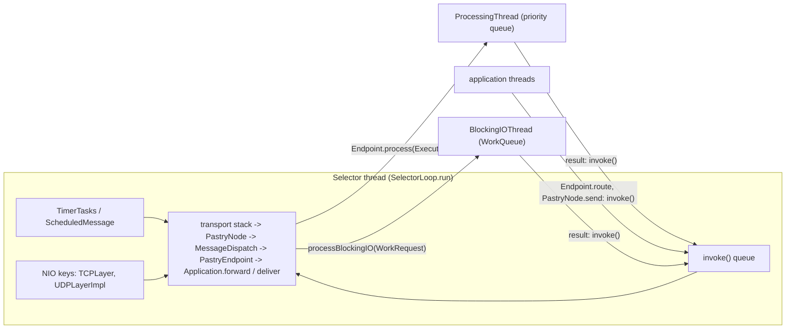
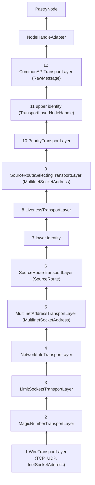

# FreePastry architecture

This is an orientation guide for developers who are new to the code base. It explains how the main pieces fit together and points to the classes that implement them. Everything here was checked against the sources in `modules/*/src/`; places where the code leaves a question open are marked **Unclear**.

FreePastry has three layers:

1. **Infrastructure**: the `Environment` (`rice.environment`), which bundles configuration, clock, randomness, logging, the selector thread (`rice.selector`) and the worker threads (`rice.environment.processing`).
2. **The overlay**: a `PastryNode` (`rice.pastry`) with its leaf set, routing table and maintenance protocols, on top of a pluggable stack of transport layers (`org.mpisws.p2p.transport.**`). The stack is either real TCP/UDP (`rice.pastry.socket`) or a discrete-event simulator (`rice.pastry.direct`).
3. **Applications**: written against the protocol-independent common API (`rice.p2p.commonapi`). These are PAST, ExpiringPast, Glacier, Aggregation, Scribe, SplitStream, Replication and Multiring (`rice.p2p.**`), with local storage from `rice.persistence`.

## Modules

The build has one Maven module per area, under `modules/`. Each line lists a module's direct dependencies; a module also sees what those depend on. There are no cycles.

```
freepastry-all             the jar with dependencies: every module below
freepastry-tutorials    -> every module below
freepastry-glacier      -> past, multiring, pastry, persistence, core
freepastry-multiring    -> scribe, pastry, core
freepastry-scribe       -> pastry, core
freepastry-past         -> persistence, core
freepastry-persistence  -> core
freepastry-peerreview   -> pki, transport, core
freepastry-pki          -> pastry, transport, core (+ Bouncy Castle bcpkix)
freepastry-pastry       -> transport, core
freepastry-filetransfer -> transport, core
freepastry-transport    -> core
freepastry-core         -> Bouncy Castle bcprov, SLF4J API
```

- **core** holds what every layer shares: `rice` (`Continuation` and friends), `rice.environment`, `rice.selector`, `rice.p2p.commonapi`, `rice.p2p.util` and the default `freepastry.params`.
- **transport** is the generic layer stack, `org.mpisws.p2p.transport.**` without PeerReview. It knows nothing about Pastry: the simulated `transport.direct.DirectTransportLayer` takes a `GenericNetworkSimulator` and a `LivenessProvider`, and the caller (`DirectPastryNodeFactory`) registers it with the `rice.pastry.direct.NetworkSimulator`.
- **past** (with replication) and **persistence** use only the common API, not `rice.pastry`; their tests use Pastry ids in test scope.
- **peerreview** (`org.mpisws.p2p.transport.peerreview.**`) is a transport layer, but it needs pki's certificates, so it is its own module above pki.

A test lives in the module whose code it tests. If it needs a higher module, it lives in the lowest module that sees everything it uses. Test helpers that other modules reuse (`TLTest`, `FreePorts`, `CommonAPITest`, `RegressionRun`, the util unit programs) ship in their module's test-jar.

## The Environment

`rice.environment.Environment` is passed to almost every constructor. It holds:

| Accessor | Type | Default | Notes |
|---|---|---|---|
| `getParameters()` | `rice.environment.params.Parameters` | `SimpleParameters` | Required: the constructor throws if it is null. |
| `getTimeSource()` | `rice.environment.time.TimeSource` | `SimpleTimeSource` (wall clock) | The simulator uses `DirectTimeSource`, a simulated clock. |
| `getRandomSource()` | `rice.environment.random.RandomSource` | `SimpleRandomSource` | Seeded from the `random_seed` parameter (`CLOCK` means seed from the time). |
| `getLogManager()` | `rice.environment.logging.LogManager` | `Slf4jLogManager` | Hands out an SLF4J `org.slf4j.Logger` per class and instance. |
| `getSelectorManager()` | `rice.selector.SelectorLoop` | a new selector thread named "Default" | See the threading section below. |
| `getProcessor()` | `rice.environment.processing.Processor` | `SimpleProcessor("Default")` | `SimProcessor` if `environment_use_sim_processor`. |
| `getExceptionStrategy()` | `rice.environment.exception.ExceptionStrategy` | `SimpleExceptionStrategy` | Called when the selector loop catches a `Throwable`. |

Ways to build one:

- `new Environment()` and `new Environment(String paramFile)` set up a real-network environment. The defaults come from `freepastry.params` on the classpath; it is the main resource `modules/core/src/main/resources/freepastry.params`. An optional mutable params file overrides the defaults.
- `Environment.directEnvironment()` sets up the simulator: a `DirectTimeSource`, a `SimProcessor` and a selector that is driven by the simulator.
- Subclasses can override `chooseDefaults()`.

Parameters are read when components are constructed, so most of them must be set before you build a node.

Logging goes through SLF4J 2. Components get their logger from `environment.getLogManager().getLogger(getClass(), instance)`. The default `Slf4jLogManager` names it `<class>[.<instance>][.<prefix>]`, where the prefix is set by `Slf4jLogManager.clone(prefix)` (node factories use the node id), and creates it with `LoggerFactory.getLogger(name)`. Classes without an environment use `LoggerFactory.getLogger(X.class)` directly. Levels, format and destinations are the job of the SLF4J backend the application provides (the tests use slf4j-simple, configured by each module's `src/test/resources/simplelogger.properties`); there are no logging parameters in `freepastry.params`. Log calls use placeholders, `logger.debug("routing {} to {}", msg, hop)`, or the lazy fluent form, `logger.atDebug().log(() -> expensive())`, so messages are only built when the level is enabled. Explicit `if (logger.isDebugEnabled())` guards remain only around multi-statement blocks or expensive arguments. Log lines carry the backend's wall-clock timestamp, not the simulator's virtual time.

`Environment.destroy()` stores the parameters. It then destroys every registered `rice.Destructible`, then the selector and then the processor, all on the selector thread (if called from another thread it uses `invoke()`). Components register themselves with `addDestructable()`. For example, `PastryNode`'s constructor calls `e.addDestructable(this)`. `cloneEnvironment()` derives a child environment that shares the parent's fate (the parent destroys it). Node factories use this to give each node its own logger name suffix, and optionally its own selector or processor.

## Threads, and what runs where

This is the most important thing to understand. FreePastry is almost entirely **single-threaded on the selector thread**. Two kinds of worker thread run CPU-heavy or blocking work, and every result comes back to the selector thread.

### The selector thread (`rice.selector.SelectorLoop`)

`SelectorLoop` extends `Thread`. `Environment` starts it, through `SelectorLoop.setEnvironment()`, which calls `start()`. Each pass through the loop in `SelectorLoop.run()` does the following:

1. Notifies `LoopObserver`s if the loop was delayed. `ConsistentJoinProtocol` uses this to detect that the process was suspended, for example a hibernating laptop.
2. `executeDueTasks()` runs every `rice.selector.TimerTask` whose time has come. `SelectorLoop` *is* the `rice.selector.Timer` (`getTimer()` returns `this`), so `schedule()`, `scheduleAtFixedRate()`, `Endpoint.scheduleMessage()` and `PastryNode.scheduleMsg()` (which wraps the message in a `ScheduledMessage`) all fire on this thread.
3. `doInvocations()` runs every `Runnable` queued with `invoke(Runnable)`, then applies pending `modifyKey()` requests.
4. `doSelections()` dispatches NIO readiness to the `SelectionKeyHandler` attached to each key (`accept`, `connect`, `read`, `write`). The keys are shuffled first, using the environment's random source.
5. `select(timeout)` waits until the next timer, for at most `SelectorLoop.TIMEOUT` (500 ms). It returns at once if invocations are pending.

An exception thrown by a task or invocation goes to `environment.getExceptionStrategy().handleException()`. The tasks that have not run yet are put back in the queue.

**What runs on the selector thread:**

- All socket and datagram IO. `org.mpisws.p2p.transport.wire.TCPLayer` and `UDPLayerImpl` are `SelectionKeyHandler`s.
- Every transport-layer callback (`TransportLayerCallback.messageReceived`, `incomingSocket`, `MessageCallback`, `SocketCallback`, `P2PSocketReceiver`).
- Liveness pings and timeouts.
- `PastryNode.receiveMessage()`, which calls `MessageDispatch`, which calls `PastryAppl.receiveMessage()`, which calls `PastryEndpoint`, which calls `Application.forward()`, `deliver()` and `update()`. **All application upcalls run here.**
- Join, leaf set and route set maintenance (`ScheduledMessage`s and the protocol message handlers).
- Every continuation handed back by the `Processor` or a `WorkRequest`.

**Rule of thumb:** don't block on the selector thread. Every blocked millisecond holds up all networking and timers of every node that shares this selector. Never wait on a result that only the selector thread can deliver: that deadlocks. The new `rice.FutureContinuation` warns about the same thing for `CompletableFuture.get()`.

`isSelectorThread()` tells code which thread it is on. Several entry points use it to move themselves onto the selector thread, so they are safe to call from any thread:

- `PastryNode.send()`: if it is not on the selector, it wraps `tl.sendMessage(...)` in `invoke()`.
- `StandardRouter.route()`: re-invokes itself on the selector. `PastryEndpoint.route()` ends in `getRouter().route(rm)`, so `Endpoint.route()` is safe from application threads.
- `PastryNode.connect()` (application sockets) and `PastryNode.destroy()`.
- `SocketPastryNodeFactory.newNode(Id, MultiInetSocketAddress)`: builds the node on the selector, using `newNodeSelector()`. If called from another thread, the caller blocks until the node is built. The code comment says this works around a bind deadlock on some Linux/JVM combinations.
- `Environment.destroy()`.

**Unclear:**

- There is no general guarantee that the rest of the API is thread-safe. Most getters (`getLeafSet()`, `getRoutingTable()`, `Endpoint.replicaSet()`, `localLookup()`) read selector-owned state without locking.
- `SocketNodeBootstrapper.boot()` is commonly called from `main` (as in `rice.tutorial.lesson3.DistTutorial`), and its code comment says it "can be called on any thread". It does not move itself onto the selector thread, though: it relies on the layers it calls (`checkLiveness`, `schedule`, `invoke`).
- If you need a consistent view of node state from another thread, run the code on the selector with `SelectorLoop.invoke()`, and use a `FutureContinuation` to wait for an asynchronous result.

One more caveat: `PastryNode.send()` to the **local** handle calls `receiveMessage()` synchronously on the caller's thread. Only sends to remote nodes are moved onto the selector thread. `receiveMessage()` is `synchronized` on the node.

### The processing thread (`SimpleProcessor`)

`Processor.process(Executable, Continuation, ...)` (normally reached through `Endpoint.process()` or `PastryNode.process()`) runs CPU-bound work off the selector thread. It is used for erasure coding and bloom filters in Glacier, bloom filters in Replication, aggregate building in Aggregation, and similar work.

In `SimpleProcessor`:

- Requests go into a `PriorityBlockingQueue` that a single `ProcessingThread` drains. The thread runs at `Thread.MIN_PRIORITY`.
- `ProcessingRequest` orders the queue by priority (lower runs first), then by submission order.
- `ProcessingRequest.run()` calls `Executable.execute()`, then delivers the result or the exception through `selectorManager.invoke(...)`. **The continuation always runs on the selector thread**, never on the processing thread.

### The blocking-IO thread (`SimpleProcessor`)

`Processor.processBlockingIO(WorkRequest)` queues a `rice.environment.processing.WorkRequest` on a `WorkQueue`, which a single `BlockingIOThread` drains.

- `WorkRequest.run()` calls `doWork()` and hands the result back with `selectorManager.invoke(...)`.
- `rice.persistence.PersistentStorage` does all its disk IO this way.
- If a bounded `WorkQueue` overflows, `WorkQueueOverflowException` is reported *on the enqueuing thread*.

`UnifiedProcessor` is a variant that kills the blocking-IO thread and runs `WorkRequest`s on the processing thread instead.

### Application threads

An application's own threads (`main`, a GUI) typically:

- build the `Environment` and the node factory,
- call `newNode()`, `boot()` and `buildEndpoint()`/`register()`,
- wait for the node with `PastryNode.awaitReadyOrJoinFailed(timeout, unit)`, usually in a loop that also checks `joinFailed()` (as in the tutorials; it returns once the node is ready or its join has failed, or after the timeout),
- call `Endpoint.route()`.

To call into FreePastry and wait for the answer, use `FutureContinuation.call(...)` and wait on the `CompletableFuture` it returns.

### Several nodes in one JVM

The node factories read three parameters:

- `pastry_factory_multipleNodes` (default `true`): each node gets a cloned environment with its own logger name suffix (the node id) and random source.
- `pastry_factory_selectorPerNode` (default `false`): each node gets its own selector thread. By default all nodes share one selector thread.
- `pastry_factory_processorPerNode` (default `false`): each node gets its own processor. By default they share one.

The cloning is done in `NodeEnvironments`, which `SocketPastryNodeFactory.cloneEnvironment()` calls. `DirectPastryNodeFactory.newNode(Id)` only clones the log manager.

### The simulator

In the simulator there is only one thread. `Environment.directEnvironment()` uses a `DirectTimeSource` and a `SimProcessor`. `SimProcessor` runs both `process()` and `processBlockingIO()` work on the selector thread itself, via `invoke()`. The work is serialized, but continuations still arrive on the selector thread.

`org.mpisws.p2p.transport.direct.EventSimulator` (the base class of `rice.pastry.direct.BasicNetworkSimulator`) does the rest:

- It calls `setSelect(false)`, so the selector never touches NIO.
- `start()` queues a self-re-invoking `Runnable`. On each run, `simulate()` advances the simulated clock to the next scheduled `TimerTask`, optionally throttled by `setMaxSpeed()`.
- Message deliveries are `TimerTask`s (`DeliveryTimerTask`), scheduled after the simulated network delay.



## The transport-layer stack

`org.mpisws.p2p.transport.TransportLayer<Identifier, MessageType>` is the interface every layer implements:

- `sendMessage(i, m, MessageCallback, options)` and `openSocket(i, SocketCallback, options)`, both of which return cancellable request handles;
- `setCallback(TransportLayerCallback)`, which receives `messageReceived` and `incomingSocket`;
- `acceptMessages()` and `acceptSockets()`, for flow control.

Each layer adds its own header to outgoing messages and sockets and strips it on the way in. Layers usually also change the identifier type, for example from `InetSocketAddress` to `SourceRoute<MultiInetSocketAddress>` to `TransportLayerNodeHandle`. The `Map<String, Object>` of options travels down the stack, and each layer applies the options it understands, for example `WireTransportLayer.OPTION_TRANSPORT_TYPE` or `PriorityTransportLayer.OPTION_PRIORITY`. Sockets are `P2PSocket`s, with readiness requested through `register(read, write, P2PSocketReceiver)`. Note the warning in the `TransportLayer` Javadoc: a callback may fire before the request method has returned.

Some layers also provide side interfaces: `LivenessProvider` (alive, suspected, dead, dead forever; `checkLiveness()`), `ProximityProvider` (round-trip-time based proximity) and `Pinger`. That is why several factory methods return bundles such as `TransLiveness` or `TransLivenessProximity` instead of a plain layer.

### Socket stack, bottom to top (`SocketPastryNodeFactory.getNodeHandleAdapter()`)

| # | Layer (factory method) | Class | Identifier | What it adds |
|---|---|---|---|---|
| 1 | wire (`getWireTransportLayer`) | `wire.WireTransportLayer` | `InetSocketAddress` | Binds TCP and UDP. `sendMessage` sends a UDP datagram, `openSocket` opens a TCP connection. |
| 2 | magic number (`getMagicNumberTransportLayer`) | `wire.magicnumber.MagicNumberTransportLayer` | same | Prefixes `PASTRY_MAGIC_NUMBER` (`0x27 0x40 0x75 0x3A`) and drops traffic without it (5 s header timeout). |
| 3 | limit sockets (`getLimitSocketsTransportLayer`) | `limitsockets.LimitSocketsTransportLayer` | same | Closes the least recently used socket beyond `pastry_socket_scm_max_open_sockets`. |
| 4 | network info (`getIpServiceTransportLayer`) | `networkinfo.NetworkInfoTransportLayer` | same | Answers "what is my external IP?" and "what is your id?" for bootstrapping and NAT probing. |
| 5 | multi-address (`getMultiAddressSourceRouteTransportLayer`) | `multiaddress.MultiInetAddressTransportLayer` | `MultiInetSocketAddress` | A node's list of addresses, from the public one to the local one, plus an epoch. `AddressStrategy` picks which address to use. |
| 6 | source route (`getSourceRouteTransportLayer`) | `sourceroute.SourceRouteTransportLayer` | `SourceRoute<MultiInetSocketAddress>` | Sends along explicit relay paths; intermediate nodes forward. |
| 7 | lower identity (`getLowerIdentityLayer`) | `identity.IdentityLayerCore` (lower half) | same | Prefixes the destination's identity and rejects traffic meant for a previous incarnation of the address. |
| 8 | liveness (`getLivenessTransportLayer`) | `liveness.LivenessTransportLayer` | same | Pings, RTT estimation, liveness events. A pong counts only if it echoes a ping this node sent on that route; at most `pastry_socket_liveness_max_trackers` routes are tracked, the least recently used idle ones are forgotten. |
| 9 | source route manager (`getSourceRouteManagerLayer`) | `sourceroute.manager.SourceRouteSelectingTransportLayer` | `MultiInetSocketAddress` | Uses the direct route while it is alive, otherwise tries relay routes from a `SourceRouteStrategy`. Provides liveness and proximity per address. |
| 10 | priority (`getPriorityTransportLayer`) | `priority.PriorityTransportLayer` | same | See below. |
| 11 | upper identity (`getUpperIdentityLayer`) | `identity.IdentityLayerCore` (upper half) | `TransportLayerNodeHandle<MultiInetSocketAddress>` | Cancels pending traffic and reports "dead forever" when the node behind an address changes. |
| 12 | common API (`getCommonAPITransportLayer`) | `commonapi.CommonAPITransportLayer` | same, message type `RawMessage` | Serializes `RawMessage`s to bytes and back, using `rice.pastry.transport.TransportLayerDeserializer`. |
| — | adapter | `rice.pastry.transport.NodeHandleAdapter` | `NodeHandle` | Combines the top layer with its liveness and proximity providers and hands them to `PastryNode.setSocketElements()`. |

The priority layer (`PriorityTransportLayer`) works like this:

- Messages that carry the `TRANSPORT_TYPE_DATAGRAM` option go straight down to UDP.
- All other messages go into a per-destination priority queue over one primary TCP socket. Lower `Message.getPriority()` values are sent first.
- The queue holds at most `pastry_socket_writer_max_queue_length` messages (30). When it is full, the lowest-priority message is dropped and its sender gets `QueueOverflowException`.
- Messages larger than `pastry_socket_writer_max_msg_size` (20480 bytes) get a socket of their own.
- Queued messages fail when the destination is declared dead.

Subclasses swap or insert layers by overriding these protected factory methods:

- `rice.pastry.socket.nat.rendezvous.RendezvousSocketPastryNodeFactory` adds `org.mpisws.p2p.transport.rendezvous` for nodes behind NATs that cannot accept connections.
- `rice.pastry.socket.internet.InternetPastryNodeFactory` adds NAT and firewall detection. UPnP is only available through a `FirewallPortOpener` named by the `nat_handler_class` parameter; the SBBI-based handler has been removed.
- `rice.pastry.socket.appsocket.AppSocketPastryNodeFactory` adds application sockets.

`org.mpisws.p2p.transport.ssl.SSLTransportLayer` (TLS for sockets, not for UDP) is not part of the default stack. The `rice.tutorial.ssl` tutorial shows how to insert it.



### How a node is assembled

The class hierarchy is `rice.pastry.PastryNodeFactory` (reads `pastry_rtMax`, `pastry_rtBaseBitLength`, `pastry_lSetSize`), then `rice.pastry.transport.TransportPastryNodeFactory`, then `SocketPastryNodeFactory` or `DirectPastryNodeFactory`. `TransportPastryNodeFactory.nodeHandleHelper(PastryNode)` is a template method that runs these steps in order:

1. `getNodeHandleFactory()` and `getLocalHandle()` (abstract; the subclasses create `SocketNodeHandle`s or `DirectNodeHandle`s);
2. a `TransportLayerDeserializer` and a `MessageDispatch`;
3. `new RoutingTable(...)`, `new LeafSet(...)` and `new RapidRerouter(...)` (the router), followed by `pn.setElements(...)`;
4. `getNodeHandleAdapter()` (abstract), which builds the transport stack, followed by `pn.setSocketElements(leafSetMaintFreq, routeSetMaintFreq, nha, nha, nha, handleFactory)`. This installs the node as the stack's callback and as a liveness and proximity listener;
5. `router.register()`, then `registerApps()`. This creates the proximity neighbor selector (`ProximityNeighborSelectionApplication` if `transport_use_pns`), the bootstrapper (abstract), `StandardRouteSetProtocol`, `PeriodicLeafSetProtocol` and `ConsistentJoinProtocol`. The leaf set protocol doubles as the node's `ReadyStrategy`. `SocketPastryNodeFactory.registerApps()` also registers a `ConnectivityProbeApplication`.

The two concrete factories differ like this:

- **`SocketPastryNodeFactory`** picks the bind address: the constructor argument, else the `socket_bindAddress` parameter, else `InetAddress.getLocalHost()`. If that is a loopback address and `pastry_socket_allow_loopback` is false, it connects to `pastry_socket_known_network_address` to find a real interface. If `pastry_socket_increment_port_after_construction` is set, the port is incremented after each node. `newNode()` builds the node on the selector thread. `boot()` goes through `SocketNodeBootstrapper`: it checks the liveness of the boot addresses (waiting up to 20 s), runs PNS on the live ones, then calls `PastryNode.doneNode()`. A boot address that reaches the node itself (same port; loopback, wildcard or a local interface address) makes it start a new ring. Any other loopback boot address is mapped to the node's own bind address with the boot address's port when the node is bound to a non-loopback address, so `127.0.0.1:9171` works as a boot address for a node listening on the LAN address.
- **`DirectPastryNodeFactory`** builds a `DirectTransportLayer` per node and registers it with the `NetworkSimulator`, which delivers its messages. Liveness and proximity come from the simulator; topologies include `EuclideanNetwork`, `SphereNetwork` and `GenericNetwork`. If `pastry_direct_guarantee_consistency` is false, it uses `StandardLeafSetProtocol` instead of the periodic one.

## The Pastry node

`rice.pastry.PastryNode` implements `rice.p2p.commonapi.Node`, and also implements the transport callback, `LivenessProvider` and `ProximityProvider`, which it delegates to the stack. It owns:

- **Ids**: `rice.pastry.Id`, with `Id.IdBitLength = 160`.
- **The leaf set**: `rice.pastry.leafset.LeafSet`, holding `pastry_lSetSize` (24) nodes, half clockwise and half counter-clockwise. `mostSimilar(key) == 0` means the local node is the key's root (`PastryNode.isClosest()`). It also backs `Endpoint.replicaSet()`, `range()` and `neighborSet()`.
- **The routing table**: `rice.pastry.routing.RoutingTable`, with `Id.IdBitLength / b` rows of `2^b` `RouteSet`s, where `b = pastry_rtBaseBitLength` (4). Each `RouteSet` holds up to `pastry_rtMax` (1) handles, chosen by proximity.
- **The router**: `rice.pastry.standard.RapidRerouter`, which extends `StandardRouter`. `receiveRouteMessage()` delivers locally if the leaf set says this node is the root. Otherwise it takes candidates from `getBestRoutingCandidates()` (leaf set first, then routing table) and lets the `RouterStrategy` pick one that is not suspected. It also patches holes in the previous hop's routing table (`checkForRouteTableHole`). `RapidRerouter` re-sends messages whose next hop fails.
- **The join and ready logic**:
  - `PastryNode.boot()` calls the `Bootstrapper`, which eventually calls `doneNode(bootHandles)`.
  - `doneNode()` schedules leaf set maintenance every `pastry_leafSetMaintFreq` seconds (60) and route set maintenance every `pastry_routeSetMaintFreq` seconds (900), then calls `JoinProtocol.initiateJoin()`.
  - `ConsistentJoinProtocol` routes a `JoinRequest` to the joiner's id. Every hop adds its routing table row, and the root replies with its leaf set (see the class Javadoc).
  - It also adds a rule: the node becomes ready only after its whole leaf set has confirmed it (based on MSR-TR-2003-94).
  - `PeriodicLeafSetProtocol` keeps the leaf set alive with `BroadcastLeafSet` and `RequestLeafSet` exchanges and leases (`pastry_protocol_periodicLeafSet_lease_period`, 30 s). As the `ReadyStrategy`, it can mark the node not ready again if its leases lapse.
  - `StandardRouteSetProtocol` periodically exchanges `RequestRouteRow` and `BroadcastRouteRow` messages.
  - Readiness changes go to `PastryNodeListener`s, and to `PastryAppl.notifyReady()` the first time only.
- **Message dispatch**: `rice.pastry.messaging.MessageDispatch` maps an application address (an `int`) to a `PastryAppl`. Pastry's own protocols are `PastryAppl`s too. If no application is registered at the address, the message is dropped. `PastryEndpoint.receiveMessage()` also drops route messages while the node is not ready, unless the endpoint `deliverWhenNotReady()` or the message is addressed to this exact node.
- **Per-node scratch space**: `getVars()`. Factories use it to pass objects between their factory methods, for example `SocketPastryNodeFactory.PROXY_ADDRESS` and `PRIORITY_TL`.

## The common API

Applications are written against `rice.p2p.commonapi`:

- **`Node`**: `buildEndpoint(Application, String instance)` returns an unregistered `Endpoint`; call `endpoint.register()` once the application is ready to receive messages. `getId()`, `getIdFactory()`, `getLocalNodeHandle()` and `getEnvironment()` complete the interface.
- **`Endpoint`** (implemented by `rice.pastry.commonapi.PastryEndpoint`):
  - `route(Id key, Message | RawMessage, NodeHandle hint, ...)` routes towards the root of `key`. With `key == null` it sends directly to `hint`.
  - `localLookup`, `neighborSet`, `replicaSet` and `range` query the node's state.
  - `scheduleMessage()` delivers a message to the local application later, on the selector thread.
  - `process()` runs a task on the processing thread.
  - `setDeserializer()` installs a raw deserializer.
  - `connect()` and `accept()` are application sockets.
- **`Application`**: `forward(RouteMessage)` is called on every hop, including the last; returning false consumes the message. `deliver(Id, Message)` is called at the root, and `update(NodeHandle, boolean joined)` when the neighbor set changes. All three are called on the selector thread.
- **`Message`**: carries `getPriority()`, from `MAX_PRIORITY = -15` to `LOWEST_PRIORITY = 15`. The priority becomes `PriorityTransportLayer.OPTION_PRIORITY`.
- **`Id`**, **`NodeHandle`**, **`IdFactory`**, **`IdRange`**, **`NodeHandleSet`**: the identifier types.

How messages are wrapped:

- An endpoint's address on the node is `StandardAddress.getAddress(appClass, instance, env)`, the first two bytes of the SHA-256 hash of the class name followed by the first two bytes of the SHA-256 hash of the instance name.
- `PastryEndpoint.route()` wraps the application message in a `PastryEndpointMessage`, inside a `rice.pastry.routing.RouteMessage` addressed to the router.
- On each hop the router calls `PastryEndpoint.receiveMessage()`, which calls `application.forward(rm)`. Then the endpoint either delivers locally (`application.deliver(...)`) or calls `getRouter().route(rm)` again.

## Callbacks: `rice.Continuation`

Every operation that can take time is asynchronous and reports through `rice.Continuation<R, E extends Exception>`, which has two methods, `receiveResult(R)` and `receiveException(E)`. Nested helper classes cover the common patterns:

- `StandardContinuation<R, P, E>` forwards exceptions to a parent continuation, so you only implement `receiveResult`.
- `ErrorContinuation` forwards results to a parent, so you only implement the error path.
- `SimpleContinuation` takes `Object` results and `Exception`s.
- `ListenerContinuation` logs and ignores. Its Javadoc says it is for testing only.
- `NamedContinuation` wraps another continuation with a name, for logging.
- `MultiContinuation` collects N results: `getSubContinuation(i)` returns one continuation per sub-operation, and `isDone()` and `getResult()` can be overridden. It is used for fan-out to replicas.

`rice.Executable<R, E>` is the task type for the `Processor`. `rice.p2p.commonapi.Cancellable` is returned by most asynchronous calls. `rice.FutureContinuation` bridges `Continuation` and `CompletableFuture`; use it to wait for an asynchronous result from outside the selector thread.

Continuations are normally called back on the selector thread, but not always asynchronously. Some implementations call the continuation before the request method has returned, for example `MemoryStorage`, `DirectPastryNodeFactory.getLeafSet()`, and transport requests that fail at once.

## Serialization

Everything on the wire is raw-serialized; there is no Java serialization. The envelope is written by `rice.pastry.transport.TransportLayerDeserializer`: `int` application address, `byte` priority, `short` type, then the payload.

- A message implements `rice.p2p.commonapi.rawserialization.RawMessage`, with `getType()` (non-zero; zero is reserved) and `serialize(OutputBuffer)`. `Endpoint.route()` accepts only `RawMessage`s. The application registers a `MessageDeserializer` with `endpoint.setDeserializer()`; it switches on the type and rebuilds the message from an `InputBuffer`. Until it does, the endpoint has `MessageDeserializer.NONE`, which rejects every message. Pastry's own protocol messages extend `rice.pastry.messaging.PastryRawMessage` and are read by subclasses of `PastryMessageDeserializer`. Messages that only go to the local node, such as the ones scheduled with `scheduleMessage()`, may be plain `Message`s.
- Content is raw in the same way: `PastContent`, `PastContentHandle` and `ScribeContent` declare `getType()` and `serialize(OutputBuffer)` and are read back by the application's `PastContentDeserializer`, `PastContentHandleDeserializer` and `ScribeContentDeserializer`. PAST starts with `PastContentDeserializer.NONE` and `PastContentHandleDeserializer.CONTENT_HASH`.
- A PAST response that a `ContinuationMessage` subclass cannot write raw is an error. An exception travels as its class name and message and arrives as a `rice.p2p.past.PastRemoteException`.

## Cryptography

`rice.p2p.util.SecurityUtils` and `rice.p2p.util.HashUtils` hold the primitives, from the JDK providers; Bouncy Castle is passed explicitly (`SecurityUtils.BOUNCY_CASTLE`) where the JDK has no equivalent, such as X.509 certificate generation, and is never registered as a JVM-wide provider:

- Hashes: SHA-256 (`HashUtils.hash()`). Ids built from data (`PastryIdFactory.buildId()`) are SHA-256 truncated to 160 bits.
- Symmetric encryption: AES-256-GCM (`encryptSymmetric()`/`decryptSymmetric()`). GCM is authenticated: a wrong key or any change to the data makes decryption throw a `SecurityException`.
- MACs: HMAC-SHA256 (`hmac()`).
- Asymmetric encryption: RSA-OAEP with SHA-256 for the hash and MGF1. Signatures: SHA256withRSA.
- Password-encrypted files (`encryptWithPassword()`/`decryptWithPassword()`): a random salt, then AES-256-GCM under a key PBKDF2-HMAC-SHA256 derives from the password.

### Trust model

The default socket stack (above) is for trusted networks only. It has no authentication and no encryption: anyone who can reach a node's port can join the ring, claim any node id (spoof a node), read the traffic, or fill a node's routing state with colluding identities (eclipse it).

Untrusted deployments need `SSLTransportLayer` plus node ids that a CA has bound to certificates. The CA issues each node one X.509 certificate with the node id as its common name (`CATool.signNodeId()`); the node's PKCS12 keystore holds it with the private key and the CA certificate. `CertifiedNodeIdFactory` takes the node's id from that certificate after checking signature, validity and key ownership (`NodeIdCertificate.verify()`), so a node cannot pick its own id. The SSL layer sits above the source-route layer and runs mutual TLS on TCP sockets, validating the peer's chain against the CA, and reports the peer certificate's subject in the socket options as `SSLTransportLayer.OPTION_CERT_SUBJECT`. `CertifiedSocketPastryNodeFactory` sets this up (strict common-name validation included, no subclassing needed); its `CertifiedIdBindStrategy`, returned from `getBindStrategy()`, tracks each id: a handle learned over the wire (no certificate) is unverified, a TLS certificate whose subject equals the id promotes it to authenticated, and a subject that differs refuses the binding and logs a warning. This is what stops id spoofing. The factory also installs an identity policy on the node (`PastryNode.setIdentityPolicy()`): the routing table and the leaf set admit a handle only once its id is authenticated (an unauthenticated one triggers a probing TLS connection and is admitted when the certificate matches), and `PastryEndpoint` hands a routed message that came from another node to its application only once the previous hop (`RouteMessage.getReceivedFrom()`, the transport's sender) is authenticated, holding it in a bounded queue meanwhile. Routing towards an id and the originator of a routed message are not gated: only the hop is authenticated, so an application that needs sender authentication signs its messages. `rice.tutorial.ssl.DistTutorial` is the working example. UDP datagrams are outside TLS and unauthenticated, so the bind strategy also decides which received messages go up (`BindStrategy.acceptsMessage`): `CertifiedIdBindStrategy` passes one up only if its options carry a certificate subject that matches the sender, that is, it arrived over a TLS socket whose certificate is the sender's. Datagrams therefore stop below the identity layer's upper half: only the layers below it (liveness pings and pongs, network-info probes) use UDP, and the factory sends messages that ask for a datagram over TLS instead. The bind strategy also decides whether a handle may replace the one bound to the same address (`BindStrategy.replace`, otherwise the newer epoch wins and the old handle is marked dead for good): in certified mode a handle without a certificate never replaces one whose id is authenticated, and a certified handle replaces an unverified one regardless of epochs. Every datagram's identity header offers a binding, so the identity layer keeps at most `pastry_socket_identity_max_bindings` of them and forgets the least recently used; `BindStrategy.keepsBinding` names the ones it must not forget, which in certified mode are those confirmed by the node's certificate (otherwise a forged header could take an authenticated node's address once its binding was forgotten).

## Configuration

Parameters come from `freepastry.params` (defaults, on the classpath) overlaid by an optional mutable params file, through `rice.environment.params.Parameters`. Components no longer read loose parameters: each reads a typed config record with a static `fromParameters(Parameters)` factory when it is constructed, for example `PastryConfig`, `PastryFactoryConfig`, `ConsistentJoinConfig`, `NetworkSimulatorConfig`, `PriorityConfig` and `NatConfig`. Set parameters before you build the component; changing them later has no effect on it.

## Persistence (`rice.persistence`)

The interfaces are asynchronous and use `Continuation`s:

- `Catalog`: `exists`, `scan`, `getSize`, …
- `Storage extends Catalog`: `store(id, metadata, obj, c)`, `unstore`, `getObject`, `getMetadata`, `setMetadata`.
- `Cache extends Catalog`: `cache`, `uncache`, `setMaximumSize`.
- `StorageManager extends Cache, Storage`: a `Storage` plus a `Cache`, implemented by `StorageManagerImpl`. This is what PAST takes as its `manager`.

The implementations:

- `PersistentStorage` stores data on disk under a root directory, with a size limit. It writes one file per object in a versioned binary format (`ObjectFileFormat`), keeps a metadata index persisted in per-directory `metadata.cache` files (`MetadataIndex`), and recovers after crashes. The values are written by the `StorageSerializer` it is built with: `PastStorageSerializer`, `GlacierStorageSerializer` or `AggregationStorageSerializer`, which use the raw serialization of the wire. Files of the old Java-serialized XML format are not read. It does all disk IO through `Processor.processBlockingIO()` and delivers results on the selector thread. Its Javadoc lists restrictions on key `toString()`s, for example no `.` or `!`.
- `MemoryStorage` is a hash table, not durable. It calls continuations synchronously.
- `LRUCache` (backed by a `Storage`) and `EmptyCache`.
- `LockManager`/`LockManager` serialize operations per id.

## Applications

**PAST** (`rice.p2p.past`, `PastImpl`): a DHT for immutable `PastContent` keyed by `Id`.

- `insert()` stores the content on the `replicationFactor + 1` nodes closest to its id, through `getHandles` and `InsertMessage`.
- `lookup()` routes a `LookupMessage` and can cache the result locally (`lookup(id, cache, c)`).
- `lookupHandles()` and `fetch()` find and retrieve particular replicas.
- Replicas are kept in place by a `ReplicaFetchCoordinatorImpl`; `PastImpl` implements `ReplicationManagerClient` and so receives `fetch()` and `remove()` calls.
- Local data lives in a `StorageManager`; an optional `trash` `StorageManager` keeps deleted objects.
- A `PastPolicy` (`DefaultPastPolicy`) decides how to fetch and validate content.
- `ContentHashPastContent` is content whose id is the hash of its data.

**ExpiringPast** (`rice.p2p.past.gc`, `ExpiringPastImpl`): PAST with versions and expiration times. `insert(obj, expiration, c)` and `refresh(ids, expirations, c)` extend the lifetime of objects; a `GCCollectMessage` scheduled every `collectionInterval` removes expired objects. Internally it wraps the node in a `ExpiringIdNode`, so that ids become `ExpiringId`s (id plus expiration) and the replication layer carries expiration information.

**Glacier** (`rice.p2p.glacier.v2`, `GlacierImpl`): durable archival storage, designed to survive large correlated failures.

- Each object is erasure-coded into `numFragments` fragments, any `numSurvivors` of which reconstruct it (`rice.p2p.glacier.ErasureCodec`, through `GlacierPolicy.encodeObject()`/`decodeObject()`). Encoding runs in `endpoint.process()`.
- Fragments are stored, with a `Manifest` that contains the fragment hashes and a signature, on the nodes responsible for `getFragmentLocation(key, fragmentIndex)`. The fragments go in `fragmentStorage`; neighbor information goes in `neighborStorage`.
- Manifests are signed by the object's owner (`GlacierDefaultPolicy`). Each node owns the objects it inserts, with an RSA key pair given to the policy. The id an application inserts under, `a`, is the object's name `N = a.toByteArray()`; Glacier stores it under the storage id `buildId(first 20 bytes of SHA-256("FreePastry Glacier id v1" || len(K) || K || N))` (`GlacierPolicy.storageId()`), where `K` is the owner's public key encoded by `SecurityUtils.encodePublicKey()` and `len(K)` its length as a 4-byte int. The manifest carries `K` and `N` next to the object hash, the fragment hashes and the expiration, and a SHA256withRSA signature (`SecurityUtils.sign()`) over a length-prefixed encoding of the storage id, the version, the object hash, the fragment hashes, the expiration, `K` and `N` (`GlacierDefaultPolicy.signedBytes()`). Every node that receives a manifest (insert, refresh, handoff, sync, manifest fetch, bulk-refresh patch) checks that `K` and `N` derive the storage id and that the signature verifies, and drops it otherwise. So a node cannot place fragments under another owner's id, and only the owner can extend an object's expiration: `refresh()` re-signs the manifest on the owner's node (`GlacierPolicy.updateManifest()` returns null on any other node), and fragment holders only verify. Because the storage id depends on the owner's key, `lookup()` and `refresh()` find only the node's own objects, and a node that loses its key pair loses access to what it stored. `GlacierImpl` has no default policy; the old stub that "signed" with the key's own bytes survives only as `InsecureGlacierPolicy` in the test sources.
- Periodic tasks synchronize fragments with neighbors using bloom filters (the `p2p_glacier_sync*` parameters), hand off fragments the node is no longer responsible for, expire neighbors, and restore missing fragments.
- `GlacierImpl` implements `ExpiringPast` and `VersioningPast`, so it can serve as the aggregate store for Aggregation.

**Aggregation** (`rice.p2p.aggregation`, `AggregationImpl`): stores many small objects efficiently in a durable store. It wraps two stores: `objectStore`, a PAST/ExpiringPast instance for fast lookups, and `aggregateStore`, typically Glacier.

- If `AggregationPolicy.shouldBeAggregated()` says so, an inserted object goes into `objectStore` at once and onto a local `waitingList` (`StorageManager`).
- A periodic flush (`p2p_aggregation_flushInterval`) packs waiting objects into an `Aggregate` and inserts it into `aggregateStore`.
- Objects that should not be aggregated go into both stores directly, the durable copy wrapped as a `NonAggregate`.
- `AggregateList` records which aggregate holds which object and is saved to `configFileName`.
- Consolidation (`p2p_aggregation_consolidation*`) repacks aggregates whose objects have mostly expired.
- Lookups that miss in `objectStore` retrieve the object from its aggregate.
- `Moraine` layers a new `ExpiringPast` over an old one, as a migration aid.

**Scribe** (`rice.p2p.scribe`, `ScribeImpl`): publish/subscribe and anycast over trees.

- Each `Topic` has a tree rooted at the node responsible for the topic id.
- `subscribe()` routes a `SubscribeMessage` towards the topic id. Nodes on the path become forwarders, and the subscriber is acknowledged with a `SubscribeAckMessage` (or told of failure with `SubscribeFailedMessage`).
- `publish()` routes a `PublishRequestMessage` to the root, which pushes a `PublishMessage` down the tree.
- `anycast()` routes an `AnycastMessage` towards the topic id and then visits tree members from its `toVisit` list until a client's `anycast()` returns true (`AnycastFailureMessage` otherwise). The order is set by the `ScribePolicy`, which can add nodes at the front or the back of the list.
- Tree repair runs every `p2p_scribe_maintenance_interval`, through `ScribeMaintenancePolicy`.
- `ScribePolicy` decides which children a node accepts.
- Clients implement `ScribeMultiClient`. Content is a `ScribeContent`, read back by the `ScribeContentDeserializer` the application sets.

**SplitStream** (`rice.p2p.splitstream`, `SplitStreamImpl`): high-bandwidth multicast. A `Channel` has `2^p2p_splitStream_stripeBaseBitLength` (16) `Stripe`s. Each stripe id is the channel id with its first `stripeBaseBitLength` bits replaced by the stripe number (`Channel.generateStripeIds`), and each stripe is a Scribe topic. Because the stripe ids differ in the first digit, each node tends to be an interior node in only one stripe tree. `SplitStreamScribePolicy` caps a node's children (`p2p_splitStream_policy_default_maximum_children`, 24).

**Replication** (`rice.p2p.replication`):

- `ReplicationImpl` keeps a set of keys replicated on the `replicationFactor + 1` closest nodes.
- Every `p2p_replication_maintenance_interval` (10 min, with a random first delay) it builds an `IdBloomFilter` of its keys for each range it shares with a replica-set member, building the filters in `endpoint.process()`. It sends the filters in a `RequestMessage` and receives the keys the other side has but it lacks.
- It calls `ReplicationClient.fetch()` for the missing keys.
- `rice.p2p.replication.manager.ReplicaFetchCoordinatorImpl` sits on top. It turns missing keys into throttled, timed-out fetches (`p2p_replication_manager_*`) and tells its `ReplicationManagerClient` to `remove()` keys it is no longer responsible for. PAST uses this layer.

**Multiring** (`rice.p2p.multiring`): hierarchical rings.

- `MultiringNode(Id ringId, Node node)` wraps a node so that ids become `RingId`s (a ring id plus an id), and endpoints become `MultiringEndpoint`s.
- A host that is a member of several rings joins its `MultiringNode`s into a `MultiringNodeCollection`.
- Each `MultiringNode` runs its own Scribe instance ("Multiring"). A node that also belongs to another ring subscribes to the topic `RingId.build(ringId, otherRingId)`. Messages for another ring are anycast, as a `RingMessage`, to that topic, so a member of both rings carries them across.

**Where the code of the big classes lives.** `GlacierImpl`, `ScribeImpl`, `AggregationImpl`, `PersistentStorage` and `PriorityTransportLayer` are facades: each keeps its public API and delegates to package-private collaborators in its own package. Examples are `GlacierInserter`, `GlacierRetriever` and `GlacierSyncProtocol`; `SubscriptionManager`, `Publisher`, `AnycastHandler` and `TreeRepair`; `AggregateFlusher`, `AggregateConsolidator` and `ObjectRetriever`; `ObjectFiles`, `StorageRecovery` and `MetadataIndex`; and `PeerMessageWriter` with `PrimarySocketOpener`. Look there for the logic behind a public method.

## Where to go next

- The tutorials in `modules/tutorials/src/main/java/rice/tutorial/` (lesson1 to lesson4, `past`, `scribe`, `splitstream`, `rawserialization`, `transportlayer`, `ssl`, …) are small, runnable programs. The HTML that goes with them is in `html/rawtutorial/`.
- The defaults and comments for every parameter are in `modules/core/src/main/resources/freepastry.params`.
- The `package-info.java` of each main package gives a one-paragraph summary.
- API docs are generated, not committed: run `./mvnw javadoc:aggregate` and open `target/reports/apidocs/index.html`.
