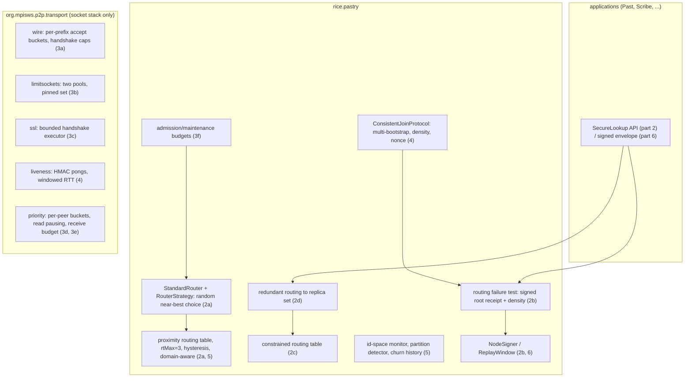

# Secure overlay design: secure routing, budgets and the adversarial harness

Status: **approved 2026-11-27** (decisions below). Read against `java25-upgrade` at `83d66fb6`; branches `q4-wb-overlay` (B1, B10) and `q4-wb-runtime` (B6, B7, B9) are in flight and not yet in the main checkout, so this design assumes they land first and does not repeat their work.

Covers roadmap items D1 (secure routing), C1–C3 (budgets), the parts of C4 (secure join) and C5 (authenticated liveness) that touch them, plus the four additions decided on 2026-11-27: adversarial harness and metrics, diversity and churn, message integrity and replay, implementation hygiene. Out of scope: privacy and metadata (wave E), PeerReview deployment (D3), certified NAT (D4), revocation (C7, referenced only where it interacts).

Conventions: file references are relative to `modules/<module>/src/main/java/` unless they start with `modules/` or `docs/`. **Unsure:** marks a claim I could not verify in the code or that rests on my memory of the literature. Sizes: **S** < 300 changed lines incl. tests, **M** 300–1000, **L** 1000–2500, **XL** more.

## Decisions (user, 2026-11-27)

- **Start:** P0 (harness and baseline), P0b (SBOM, dependency scanning, jqwik spike) and P2 (socket budgets) now; P2 after wave B runtime is merged (done 2026-11-27).
- **Q2 secure routing:** (b) opt-in per lookup; join, constrained-table maintenance and replica-set lookups always secure.
- **Q3 signatures:** (c) the existing RSA-2048 node keys now, Ed25519 together with the short-lived certificates of C7.
- **Q4 failure domain:** (b) CA-asserted certificate extension, config override, IP-prefix fallback.
- **Other questions:** the recommendations stand until the user says otherwise: Q1 (b), Q5 (a), Q6 (b), Q7 (a after spike, else c), Q8 (c), Q9 (a), Q10 (a), Q11 (b), Q12 (c), Q13 (c), Q14 (a), Q15 (a).

## 1. Goals and non-goals

### Goals

1. A yardstick first: an adversarial harness in the direct simulator that produces the section-9 metrics (delivery ratio, lookup success, routing-table and leaf-set diversity, convergence and recovery time, resource amplification) with fixed seeds, so every later phase is a red/green change against a recorded baseline.
2. In certified mode, with a malicious certified minority of fraction `f` (target: `f ≤ 0.2`, stretch `0.25`), a lookup that asks for it reaches the correct root (or the correct replica set) with high probability, even when the colluders sit close to the victim in RTT and drop or misroute messages.
3. No remote party can exhaust a node's sockets, handshake CPU, receive memory, selector time or maintenance work in a way that evicts or starves honest *established* state (leaf set, routing table, open TLS peers with traffic).
4. A joining node cannot be captured by one malicious bootstrap or root; liveness and RTT cannot be forged by an on-path peer.
5. Peer selection spreads over failure domains (AS, operator, site); the node notices id-space anomalies and ring partitions; churn does not let an attacker rotate itself into slots.
6. Applications can opt into end-to-end authenticity and replay protection for routed messages; this shares one signing service with the root receipts of secure routing.
7. Hygiene: the build reports vulnerable dependencies; the join and leaf-set protocols get explicit state machines with property-based tests.

### Non-goals

- A malicious majority, or a malicious CA (accepted risks, `docs/presentation/source/slides/risks.html`).
- Plain mode security: plain mode must only "not crash" (ROADMAP.md header). Budgets (part 3) apply to both modes because they are about crashes and starvation; secure routing, secure join and HMAC liveness are certified-mode features (plain mode keeps today's behaviour unless a param turns them on).
- Wire compatibility with old releases (not required, SECURITY-HANDOFF.md "How to work").
- Privacy (lookup inference, fingerprinting): wave E.
- Byzantine-fault-tolerant storage semantics for Past beyond quorum/signed reads (C6 stays its own item; this design only provides redundant routing to the replica set that C6 and B3 will use).

## 2. Threat model

| Actor | Capabilities | Not able to |
| --- | --- | --- |
| **Outsider** (no certificate) | Reach any node's TCP and UDP ports from many IPv4 /24s and IPv6 /64s; open connections, start TLS handshakes, send datagrams (liveness pings, network-info probes) with spoofed source addresses for UDP; be on-path for some links | Finish a mutual-TLS handshake (`SSLTransportLayer.CLIENT_AUTH_REQUIRED`, `pastry/.../socket/CertifiedSocketPastryNodeFactory.java:113-115`); get a message above the identity layer (`BindStrategy.acceptsMessage`, ARCHITECTURE.md "Trust model"); enter a routing table or leaf set |
| **Malicious certified insider** (fraction `f` of nodes, colluding) | Everything an outsider can, plus: complete TLS; be admitted to tables; forward, drop, delay, misroute, or modify messages it relays; answer join requests, leaf-set and route-row requests with chosen (real, colluding) handles; answer pings quickly from hosts placed near victims; come and go (churn) at will; act as a bootstrap | Choose its node id (CA assigns ids with SecureRandom, ROADMAP B6); claim another node's id at its own address (admission per (id, address, epoch), SECURITY-HANDOFF.md `6db04059`); forge another node's signature |
| **On-path attacker** (outsider or insider on a link) | Observe and echo UDP ping nonces, so forge PONGs for a route it sits on (SECURITY-HANDOFF.md "On-path liveness spoofing"); delay packets | Read or change TLS traffic |
| **Out of scope** | Malicious majority; compromised CA key; certificates of caught insiders stay valid until C7 | |

Assumptions: node ids are uniformly random over the 160-bit space (CA); clocks are loosely synchronised (needed only for replay windows, part 6, with a tolerance of minutes); the CA can add certificate extensions (part 5).

Why routing is the weak point today: with `pastry_rtMax = 1` (`modules/core/src/main/resources/freepastry.params:10`) each slot holds one handle, and a full slot is replaced only by a handle with a strictly lower proximity (`pastry/.../routing/RouteSet.java:175-188`); PNS fills slots by RTT (`pastry/.../pns/ProximityNeighborSelectionApplication.java:467` `getNearest`), and `MinRTTProximityProvider` keeps the minimum RTT ever seen (`transport/.../proximity/MinRTTProximityProvider.java:155`). Colluders placed near the victim therefore win slots well above their share `f`. A routed message is acknowledged hop by hop only (`pastry/.../standard/StandardRouter.java:197-220`), and `RapidRerouter` reroutes only on transport failure or suspicion (`pastry/.../standard/RapidRerouter.java:86-101`), so a hop that accepts and drops is invisible. With `h ≈ log16 N` hops and an independent fraction `p` of malicious entries per hop, a lookup succeeds with about `(1-p)^(h-1)`; for N = 10 000 (`h ≈ 3.3`) and `p = 0.2` that is about 0.6, and PNS bias pushes `p` above `f`. This is the standard argument of Castro et al.; the numbers are my arithmetic, not measured — the harness measures them (part 1).

## 3. Design overview

The direct simulator runs everything in `rice.pastry` but **none** of the socket stack: `DirectPastryNodeFactory` builds a `DirectTransportLayer` per node and takes liveness and proximity from the simulator (`pastry/.../direct/DirectPastryNodeFactory.java:219-251`), and messages travel as objects, not bytes (SECURITY-HANDOFF.md "Simulator blind spot"). So parts 2, 4 (join), 5 and 6 are tested in the harness; parts 3 and 4 (liveness HMAC, windowed RTT) are tested with unit tests on the layers under a manual clock and with the socket-ring tests (`SocketRing`, `WireRoundTrip` in the pastry test-jar).

## 4. Part 1 — adversarial harness and metrics (built first)

### Mechanism

An `AdversarialRing` builder creates a direct-simulator ring with a fixed seed, `N` nodes, a malicious fraction `f`, an id placement, a behaviour set, churn and failure domains; it drives a workload (random lookups, joins, Past inserts/lookups where a scenario needs them) and records metrics against an **oracle** that knows every live node and therefore the correct root and replica set of every key at every simulated instant.

Node roles and behaviours (each a small strategy object, combinable):

| Behaviour | How it is injected (existing seam, or new seam) |
| --- | --- |
| `Drop` (all, or with probability, or only for keys in a target range) | A `RouterStrategy` (`pastry/.../routing/RouterStrategy.java:45`) installed through `TransportPastryNodeFactory.getRouterStrategy(pn)` (used at `pastry/.../transport/TransportPastryNodeFactory.java:103`) that returns null; the upstream hop has already seen its hop ack, so the drop is silent, as in reality |
| `Misroute` (forward to the colluder closest to the key, or to a random colluder) | Same `RouterStrategy`; candidates come from the harness's colluder registry |
| `LieInJoin` (root answers a joiner with a leaf set of colluders only) | New protected hook in `ConsistentJoinProtocol` (today `respondToJoiner` is private, `pastry/.../standard/ConsistentJoinProtocol.java:414`): `protected LeafSet leafSetForJoiner(JoinRequest)`; subclass returned from `getJoinProtocol` (`TransportPastryNodeFactory.java` ~`:157`) |
| `PoisonRows` (answer `RequestRouteRow`, and push unsolicited `BroadcastRouteRow`, with colluders only) | Subclass of `StandardRouteSetProtocol` (`pastry/.../standard/StandardRouteSetProtocol.java:123-153`) via `getRouteSetProtocol`; the victim accepts any row today (it `put`s every live handle, `:128-140`) |
| `PoisonLeafSet` (broadcast leaf sets of colluders) | Subclass of `PeriodicLeafSetProtocol` via `getLeafSetProtocol` (merge path `pastry/.../standard/PeriodicLeafSetProtocol.java:202-233`) |
| `FastPing` (appear closest in RTT to chosen victims) | Proximity override in a harness subclass of `DirectPastryNodeFactory.getNodeHandleAdapter` (`DirectPastryNodeFactory.java:227-231` returns `simulator.proximity(...)`): proximity(victim → colluder) is multiplied by a factor `< 1` (default 0.1). Models colluders hosted next to the victim, and an on-path pong forger |
| `Selective` (behave honestly for maintenance, attack only application traffic) | Predicate on `RouteMessage.getAuxAddress()` |
| `ChurnRotate` (leave and rejoin to re-roll table positions) | Harness churn driver restricted to malicious nodes |

Id placement: `UNIFORM` (the certified-mode reality), `CLUSTER(target, width)` (models a CA compromise or plain-mode id choice, for the density tests), `INTERLEAVED(victim)` (colluders on both sides of one victim in the id space; only meaningful with a compromised CA, kept for the leaf-set tests).

Churn: Poisson arrivals with rate `λ` and exponential or Pareto session times (`α = 1.5` heavy tail, configurable); departures are crash (`BasicNetworkSimulator.remove`, `pastry/.../direct/BasicNetworkSimulator.java:138`) or graceful (`PastryNode.destroy()`). All draws come from one seeded `RandomSource` owned by the harness.

Failure domains: `K` domains (default 16); the harness assigns each node a domain and places domains as regions of the topology (sphere or Euclidean), so RTT correlates with domain and PNS naturally creates monoculture. A "domain outage" event removes every node of a domain at once.

Metrics (all per run, per phase window, with mean and 5th percentile over seeds):

| Metric | Definition |
| --- | --- |
| Delivery ratio | messages delivered to the oracle's root of the key / messages sent by honest nodes |
| Lookup success | lookups whose result (root, or replica set for replica scenarios) equals the oracle's within a deadline (default 30 s simulated) |
| Malicious share | fraction of routing-table entries (proximity table, constrained table separately) and leaf-set entries of honest nodes that are malicious; compared to `f` |
| Diversity | Shannon entropy `H = -Σ p_d log2 p_d` over failure domains `d` of a node's routing-table entries and of its leaf set, normalised by `log2(min(K, entries))`; mean and 5th percentile over honest nodes |
| Convergence time | join → leaf set equals the oracle's (honest joiner) |
| Recovery time | after an event (domain outage, attack start, churn burst) until the delivery ratio is back to ≥ 99 % of its pre-event value |
| Resource amplification | messages (and estimated bytes) sent by honest nodes per message sent by malicious nodes, and per lookup; bytes are estimated by serializing messages in a `GenericSimulatorListener` (`pastry/.../direct/NetworkSimulator.java:143-181`) only when the metric is enabled, because it costs CPU |

Output: one JSON line per run under `target/adversary/` plus a Markdown table for the PR; tests assert thresholds.

### Where it goes

- Test scope, `modules/pastry/src/test/java/rice/pastry/adversary/` (`AdversarialRing`, `Behaviour` and implementations, `Oracle`, `Metrics`, `ChurnDriver`, `FailureDomains`, `AdversarialDirectPastryNodeFactory extends DirectPastryNodeFactory`), shipped in the pastry test-jar so Past and Scribe scenarios can reuse it from their own modules (`past` already has pastry in test scope, ARCHITECTURE.md "Modules").
- Main-code seams only: the protected `leafSetForJoiner` hook in `ConsistentJoinProtocol`, and a `getRouter(...)` factory method instead of `new RapidRerouter(...)` at `TransportPastryNodeFactory.java:103` (needed later for the secure router, harmless now).

### Determinism

The simulator is single-threaded (ARCHITECTURE.md "The simulator"); `NetworkSimulator` uses its own seeded random when `pastry_direct_use_own_random` is set (`NetworkSimulator.java:63-71`); `DirectNodeHandle.hashCode` is the id's (`pastry/.../direct/DirectNodeHandle.java:153`), so hash iteration order is stable. The harness sets `random_seed` explicitly (default `CLOCK`, `freepastry.params:55`) and never uses `SecureRandom`. **Unsure:** whether any code reachable in the simulator draws from a static `SecureRandom` or wall-clock time; the liveness nonce source (`transport/.../liveness/LivenessTransportLayer.java:133`) is not on the simulator path. Phase 0 adds a determinism test: two runs with the same seed must produce byte-identical metric lines.

### Baseline (recorded before any fix)

Matrix: `N ∈ {200, 1000}`, `f ∈ {0, 0.1, 0.2, 0.3}`, behaviours `{none, Drop, Drop+FastPing, Misroute+FastPing, LieInJoin, PoisonRows+FastPing}`, placement `UNIFORM`, churn `{none, median session 1 h}`, 5 seeds. Default build runs a smoke subset (`N = 200`, 2 cells, 1 seed, budget < 60 s); the full matrix runs under `-Pintegration` and writes the baseline table into the PR. **Unsure:** simulator speed for N = 1000 with ConsistentJoin; if a cell takes more than a few minutes, the matrix drops to N = 500.

### Test strategy

The harness proves itself: with `f = 0`, delivery ratio and lookup success are 1.0 and convergence completes; with `Drop` at `f = 0.2`, lookup success is below a threshold that the analysis predicts (sanity, not a target). The baseline cells become the red tests of later phases, kept as `@Tag("adversary")` tests with thresholds that fail today.

### Cost

Test code only, apart from two seams. Build time: the smoke subset adds < 1 min to the default build.

## 5. Part 2 — secure routing (Castro et al.)

Reference: M. Castro, P. Druschel, A. Ganesh, A. Rowstron, D. Wallach, "Secure routing for structured peer-to-peer overlay networks", OSDI 2002. Its three ingredients are secure id assignment (the CA, done), secure routing-table maintenance (constrained table), and secure message forwarding (routing failure test plus redundant routing). The design keeps the proximity table for normal, fast routing and uses the secure path only when a caller asks for it or a failure test fails, as the paper proposes.

### 2a. Cheap first step: several candidates per slot, random choice, hysteresis

Mechanism:

- `pastry_rtMax` default 3 in certified mode (`CertifiedSocketPastryNodeFactory` overrides the factory config; see question Q1). `RoutingTable` already sizes `RouteSet`s from it (`pastry/.../transport/TransportPastryNodeFactory.java:100`).
- **Random near-best choice:** a new `RandomizedRouterStrategy` replaces `AliveRouterStrategy` (`StandardRouter.java:88-110`) when secure routing is on. Among the live candidates of the best `RouteSet` (first entries of `getBestRoutingCandidates`, `StandardRouter.java:285-374`) it picks uniformly among those whose proximity is within `pastry_route_random_rtt_factor` (default 2.0) of the best, so PNS keeps most of its latency benefit while a single fast colluder no longer wins every message. Leaf-set routing stays deterministic (the root is defined by ids).
- **Replacement hysteresis** in `RouteSet.put` (`RouteSet.java:122-191`): a full set replaces its worst entry only if the newcomer is better by a margin (`proximity(new) < (1 - pastry_rt_replace_margin) × proximity(worst)`, default margin 0.2) **and** the worst entry has been in the set at least `pastry_rt_min_tenure_millis` (default 600 000) — unless the worst entry is dead (`:134-146`, unchanged). The set records the insertion time per entry (local state, not on the wire).
- **Domain-aware replacement** (part 5): a replacement may not reduce the number of distinct failure domains in the set.
- **Windowed RTT** (from C5, moved here because it is the cheap fix for `FastPing`): `MinRTTProximityProvider` keeps the median of the last `transport_proximity_window` (default 8) samples younger than `transport_proximity_max_age_millis` (default 600 000), instead of the minimum ever (`MinRTTProximityProvider.java:152-159`). The 5 s ping throttle (`:64`) becomes `transport_proximity_ping_throttle_millis`.
- **Unsolicited rows:** `StandardRouteSetProtocol` accepts a `BroadcastRouteRow` it did not ask for and puts every live handle (`StandardRouteSetProtocol.java:123-141`); `StandardRouter.checkForRouteTableHole` sends such unsolicited patches (`StandardRouter.java:414-475`). Rule: unsolicited rows are processed at most once per peer per `pastry_rt_unsolicited_row_interval_millis` (default 5 000, the existing patch throttle `StandardRouter.java:474`) and only the sender itself (the authenticated previous hop, as B1 does for leaf sets) is put directly; the other handles become **candidates** that need a second, independent source (a requested row from another node, or our own ping) before they may replace a tenured entry.

Wire/API: no wire change. `RouteSet` serialization already carries its capacity (`RouteSet.java:478-500`); with `rtMax = 3` `BroadcastRouteRow` and the rows pushed into `JoinRequest` (`pastry/.../join/JoinRequest.java:160`) grow about 3×. A join through ~4 rows × 16 columns × 3 handles × ~60 bytes is ~11 KB, under `pastry_socket_writer_max_msg_size = 20480` (`freepastry.params:85`); larger rings or many multi-addresses may cross it and fall back to a big-message socket. **Unsure:** the serialized size of a `SocketNodeHandle` with several addresses; Phase 1 measures it.

Params (new unless noted): `pastry_rtMax` (existing, 1 → 3 in certified mode), `pastry_route_random_rtt_factor = 2.0`, `pastry_rt_replace_margin = 0.2`, `pastry_rt_min_tenure_millis = 600000`, `pastry_rt_unsolicited_row_interval_millis = 5000`, `transport_proximity_window = 8`, `transport_proximity_max_age_millis = 600000`, `transport_proximity_ping_throttle_millis = 5000`.

Selector and simulator: all on the selector thread (`RoutingTable.put` asserts it, `RoutingTable.java:441`); the random choice draws from the node's `RandomSource`, which is seeded in the simulator. In production `SimpleRandomSource` wraps `java.util.Random` (`core/.../environment/random/simple/SimpleRandomSource.java:114`), which an observer can predict; the certified factory therefore gives the router a `SecureRandom`-backed `RandomSource` (new small class), while the simulator keeps the seeded one.

Test (red/green): harness cell `f = 0.2, Drop+FastPing, UNIFORM`: malicious share of proximity-table entries of honest nodes drops from the baseline (expected ≫ 0.2) to ≤ 0.3, and lookup success rises by a margin fixed after the baseline. Unit tests for `RouteSet.put` hysteresis and domain rule (property tests, part 7). Windowed RTT: unit test with a manual clock — one forged low sample no longer sticks.

Cost: routing-table memory ×3 (about 60 → 180 handles for N = 10⁴); more pings while sets fill (`RouteSet.put` pings every new handle, `RouteSet.java:163`); row messages ×3. Routing latency: mean stretch rises slightly (bounded by the RTT factor). **Unsure:** how much; the harness reports stretch as an extra metric.

### 2b. Routing failure test: signed root receipt and density test

Mechanism: a lookup with `SendOptions.secure()` carries a 64-bit random nonce. The node that delivers it as root (`StandardRouter.receiveRouteMessage`, `lsPos == 0`, `StandardRouter.java:236-240`) sends a `RootReceipt` directly to the originator: `(key, nonce, rootHandle, leafSetIds[≤ pastry_lSetSize], timestamp)` signed with the root's certificate key, plus the root's certificate (the originator is usually not a TLS peer of the root, so it cannot take the key from the TLS session). The originator checks: signature and certificate chain against the CA trust store (`CertifiedSocketPastryNodeFactory.trustStoreOf`); certificate CN equals the root's id; the key lies within the receipt's leaf-set range and the root is the closest id in it; **density**: the mean id spacing `μ_r` of the receipt's leaf set is compared with the originator's estimate `μ_l` of the global spacing (part 5 monitor, initially the mean spacing of its own leaf set); the test fails if `μ_r > γ · μ_l` (the set is too sparse: honest nodes were omitted) or `μ_r < μ_l / γ` (too dense: concentrated ids). Default `γ = 2.0`, tuned with the harness against false positives under churn. **Unsure:** the γ Castro et al. found best; I recall a value close to 1.5 for their setting, but the harness must decide. A missing receipt within `pastry_secure_receipt_timeout_millis` (default 5 000) also fails the test.

On failure the originator retries with redundant routing (2d); the lookup result returned to the caller says which path produced it.

Where:

- New package `rice.pastry.secure` (pastry module): `NodeSigner` (sign/verify with the node's key; in the simulator a deterministic `SimulatedSigner` that "signs" with a per-node secret known to the harness, so malicious nodes cannot forge honest receipts but runs stay deterministic), `RootReceipt` (a `PastryRawMessage`), `RoutingFailureTest`, `DensityTest`.
- `StandardRouter`: on root delivery of a message with the secure flag, emit the receipt (before handing the message to the application, so a malicious application layer is not involved; the root is honest or not as a whole).
- `CertifiedSocketPastryNodeFactory`: builds the `NodeSigner` from the key store it already loads (it passes `store` and `keyPassword` to `SSLTransportLayer`, `:113-115`).

Wire: `RouteMessage` version 2 (`pastry/.../routing/RouteMessage.java:288-335` documents v0/v1; `pastry_protocol_router_routeMsgVersion = 1`, `freepastry.params` "the version number of the RouteMessage"): adds a flags byte (bit 0 = secure, bit 1 = redundant copy) and, if secure, the nonce and the originator handle. New message type `RootReceipt` at the router's address. Receipts are sent directly over TLS to the originator.

API: `SendOptions.setSecure(boolean)` (local), and a new `rice.p2p.commonapi.SecureLookup` interface on `Endpoint` (see 2d) — existing `route()` calls are unchanged.

Params: `pastry_secure_routing = true` in certified mode, `false` in plain mode; `pastry_secure_receipt_timeout_millis = 5000`; `pastry_secure_density_gamma = 2.0`; `pastry_secure_receipts_per_second = 50` and `pastry_secure_receipts_per_peer_per_second = 5` (signing is CPU: part 3f).

Selector thread: verification of an RSA-2048 signature is cheap (tens of microseconds), signing costs about 1–2 ms (**unsure**: depends on the host; Phase 4 measures). Signing runs on the processing thread through `Endpoint.process` and comes back with `invoke()` (ARCHITECTURE.md "The processing thread"), bounded by the receipt budget so a lookup flood cannot fill the unbounded processor queue (`core/.../environment/processing/simple/SimpleProcessor.java:71`).

Test: harness cell `f = 0.2, Drop` with `secure()` lookups: without the test, failures are silent; with it, every dropped lookup is detected (detection rate ≥ 0.99, false-positive rate ≤ 0.01 under `f = 0` with churn). Cell `LieInJoin`-style roots (a colluder root answering with a colluder leaf set) fail the density test.

Cost per secure lookup: one extra message (~24 ids × 20 B + certificate ~1 KB + signature 256 B ≈ 1.8 KB), one signature at the root, one verification at the originator.

### 2c. Constrained routing table

Mechanism (Castro et al.): beside the proximity table, each node keeps a constrained table of the same shape whose entry `(row r, column c)` must be the live node whose id is numerically closest to the point `p(r, c)` = the local id with digit `r` replaced by `c` (digits above `r` equal to the local id, digits below `r` too). Such an entry is verifiable: anyone can compute `p` and check closeness. Filling and maintenance:

- For each slot, the node runs a **secure lookup of `p(r, c)`** (2b) and takes the verified root; the root's receipt also lists its leaf set, which fills neighbouring slots without more lookups when they share the root region. Rows beyond `⌈log16 N⌉ + 1` are empty and skipped (N from the part-5 estimate).
- A candidate learned elsewhere (rows, leaf sets) replaces an entry only if it is strictly closer to `p` **and** it is verified: it answers a direct request with a signed statement of its leaf-set neighbours that the density test accepts, or a second secure lookup confirms it. Dead entries are refilled by lookup.
- Periodic refresh every `pastry_secure_crt_refresh_millis` (default 3 600 000) of a random fraction of slots, to follow churn.

Routing with it: only secure lookups' redundant copies (2d) and constrained-table maintenance use it; normal messages use the proximity table.

Where: `rice.pastry.secure.ConstrainedRoutingTable` (reuses `RouteSet` with capacity 1 and a closeness-to-point policy instead of proximity), `ConstrainedTableMaintenance` (a `PastryAppl` like `StandardRouteSetProtocol`), `SecureRouter extends RapidRerouter` (installed through the new `getRouter` seam) which picks from the constrained table for messages with the redundant flag. Admission: entries pass `PastryNode`'s identity policy like the proximity table (`PastryNode.setIdentityPolicy`, `pastry/.../PastryNode.java:456-460`).

Wire: a `RequestNeighbours`/`SignedNeighbours` pair (the latter is a `RootReceipt` without a routed message, so one type with a flag).

Params: `pastry_secure_crt = true` (certified), `pastry_secure_crt_refresh_millis = 3600000`, `pastry_secure_crt_fill_rate_per_second = 2` (spreads the initial fill: ~60 lookups take ~30 s after join).

Selector and simulator: maintenance is timer-driven on the selector; in the simulator the fill runs at simulated speed. Join completes before the constrained table is full; until then, redundant routing falls back to the leaf set and the filled part.

Test: harness cell `f = 0.2, PoisonRows+FastPing`: malicious share in the constrained table ≈ `f` (± sampling error) while the proximity table's share is far above; secure lookups succeed with ≥ 0.99 (provisional, Q12).

Cost: ~60 extra handles per node; ~60 secure lookups at join (each ~h+1 messages plus one receipt) spread over ~30 s; refresh ~1 lookup per minute per node. **Unsure:** the paper reports the constrained table's latency penalty only for redundant copies; ours is the same because normal traffic stays on the proximity table.

### 2d. Redundant routing to the replica set

Mechanism: after a failed failure test, or when the caller asks for it (`SecureLookup.replicaSet(key, k)`, used by join and later by Past for B3/C6), the originator sends `r` copies (`pastry_secure_redundancy = 4`) of the lookup, each starting at a different member of its own leaf set chosen to cover distinct failure domains, each forwarded **only via constrained tables** (redundant flag). Every copy's root returns a signed receipt. The originator unions the leaf sets of all verified receipts, keeps the `k` ids closest to the key that pass admission, and — Castro's neighbour-set anycast — contacts them directly for the operation. The lookup succeeds if at least one copy reached an honest root, which with independent paths has probability about `1 - (1 - (1-f)^h)^r`. (My arithmetic; the harness measures it.)

Where: `rice.pastry.secure.RedundantRouting`; API `rice.p2p.commonapi.SecureLookup` with `CompletableFuture<NodeHandleSet> replicaSet(Id key, int k)` and `CompletableFuture<NodeHandle> root(Id key)` (futures, following the futures migration), obtained via `Endpoint.secureLookup()` (returns an unsupported implementation in plain mode).

Past: redundant replica-set lookup replaces the trust in one root's answer when Past asks for `replicationFactor + 1` handles (`past/.../PastImpl.java:924`) and when the root checks the replica set (`PastImpl.java:715`, `:758`). That change belongs to B3/C6, after the futures migration (`q4-futures2`), and only uses this API.

Params: `pastry_secure_redundancy = 4`, `pastry_secure_lookup_timeout_millis = 15000`.

Test: harness Past scenario (in `past` module tests) `f = 0.2, Drop+Misroute`: replica-set lookups return the oracle's replica set with ≥ 0.99 (provisional).

Cost: `r × (h + 1)` messages plus `r` receipts per redundant lookup (≈ 4 × 5 + 4 = 24 messages for N = 10⁴), used only after a failed test or for critical operations.

## 6. Part 3 — rate limiting and budgets

Principle: **at a limit, refuse or slow the newcomer; never evict honest established state.** Established state = TLS-authenticated sockets with recent traffic, and sockets of peers in the leaf set, either routing table, or with in-flight messages ("pinned").

All budgets are token buckets driven by the environment's `TimeSource` (manual in tests), held in bounded LRU maps keyed by peer or prefix (`IPv4 /24`, `IPv6 /64`; params `transport_prefix_bits_v4 = 24`, `transport_prefix_bits_v6 = 64`). A shared `org.mpisws.p2p.transport.util.TokenBucket` and `PrefixKey` utility (transport module) serve every layer. Everything runs on the selector thread, so buckets need no locks.

### 3a. Accept and handshake budgets (wire layer, C1)

Today: at most `transport_wire_max_handshaking_sockets_per_address = 32` per remote **IP** (`transport/.../wire/TCPLayer.java:65`, `:216-226`), 10 s handshake deadline, 64 datagrams per selection (`transport/.../wire/UDPLayerImpl.java:212`). 10 IPs in one /24 get 320 handshakes.

Change: key the handshake count by prefix; add an accept token bucket per prefix and a global one; add a global cap on sockets in the handshake. At the limit the newly accepted socket is closed at once (no read). Datagrams: a per-prefix datagram bucket before the magic-number layer; excess datagrams are dropped unread beyond the 64-per-selection cap.

Params: `transport_wire_max_handshaking_sockets_per_prefix = 32` (replaces the per-address param), `transport_wire_max_handshaking_sockets = 256`, `transport_wire_accept_rate_per_prefix = 10/s` burst 20, `transport_wire_accept_rate = 100/s` burst 200, `transport_wire_datagram_rate_per_prefix = 200/s` burst 400.

### 3b. Two socket pools (limit-sockets layer, C1)

Today: `LimitSocketsTransportLayer` (layer 3, below TLS) closes the least recently used socket beyond `pastry_socket_scm_max_open_sockets = 300` (`transport/.../limitsockets/LimitSocketsTransportLayer.java:92`, `:150-162`), counting pre-TLS sockets, so 10 IPs × 32 handshakes evict every TLS peer (ROADMAP C1).

Change: an `LSSocket` starts in the **unauthenticated pool** (`pastry_socket_scm_max_unauthenticated_sockets = 128`) and moves to the **established pool** (`pastry_socket_scm_max_open_sockets = 300`, existing) when a layer above calls `handshakeCompleted()` (`P2PSocket.java:107`; the priority layer calls it after reading its header, `transport/.../priority/IncomingSocketDispatcher.java:101-111`; `SocketWrapperSocket.java:177` passes it down, so `LSSocket` can intercept it). Overflow of the unauthenticated pool closes the **oldest unauthenticated** socket (they are all equally untrusted and young ones may be honest). Overflow of the established pool closes the least recently used **unpinned idle** established socket; if all are pinned, the new socket is refused. Pinning: a `SocketPinPolicy` callback set by the Pastry factory answers "is this address in my leaf set / routing tables / has in-flight messages" (the layer only sees addresses, so the policy maps address → handle through the node). Outgoing sockets the node opens itself count in the established pool from the start.

### 3c. Bounded handshake executor (ssl layer, C1)

Today: TLS delegated tasks (the RSA work) run on the shared processing thread (`transport/.../ssl/SSLSocketManager.java:348-356`) behind an unbounded `PriorityBlockingQueue` (`SimpleProcessor.java:71`), so a handshake flood delays Glacier, replication and every other `process()` caller.

Change: `SSLTransportLayer` gets its own `ThreadPoolExecutor` (`transport_ssl_handshake_threads = 2`, bounded queue `transport_ssl_handshake_queue = 64`); results come back with `invoke()` as today. On rejection the socket is closed (only incoming, unauthenticated sockets can be rejected; an outgoing handshake the node started waits in a separate small reserved slot so the node can always dial its own neighbours). Also enables TLS session resumption later (ARCHITECTURE.md TODO, `SSLTransportLayer` handshake) — not in scope.

Simulator: not involved (no TLS); the executor is created by the socket factory only.

### 3d. Per-peer message budgets and fair scheduling (priority layer, C2)

Today: the reader delivers each complete message synchronously into the stack on the selector thread (`transport/.../priority/PrimarySocketBufferReader.java:117`); selection keys are shuffled each pass (ARCHITECTURE.md "The selector thread"), so sockets are served roughly fairly, but a peer with many sockets or a cheap-to-send, costly-to-handle message stream gets an unfair share, and the outgoing queue is per destination (`transport/.../priority/PeerMessageWriter.java:108`, bounded at 30).

Change (recommended first step, Q5):

- A per-peer message bucket (key: the authenticated identifier once known, else the prefix) checked in `PrimarySocketBufferReader.done` and `BigMessageReader` before `messageReceived`. When empty, the reader **stops reading** that socket (does not re-register read interest) and schedules a timer to resume when the bucket has a token. TCP backpressure then slows the sender; nothing is dropped, and other peers are unaffected.
- A per-prefix bucket on top, so many identities behind one /24 share one allowance.
- Selector time cap: at most `pastry_socket_max_messages_per_pass = 256` messages delivered per selector pass across all peers; the remainder resume next pass (also bounds latency for timers).
- Deficit round robin with per-peer inbound queues (full fair queuing) is option (b) in Q5, only if the harness or a socket flood test shows starvation remains.

Params: `pastry_socket_peer_msg_rate = 200/s` burst 400, `pastry_socket_prefix_msg_rate = 1000/s` burst 2000, `pastry_socket_max_messages_per_pass = 256`. Established, pinned peers get a 4× allowance (`pastry_socket_pinned_rate_factor = 4`) so maintenance bursts of honest neighbours are never throttled first.

### 3e. Receive-memory budget with per-peer shares and deadlines (C3)

Today: a node-wide budget `pastry_socket_writer_max_big_msg_in_flight = 64 MB` for big messages (`transport/.../priority/BigMessageBudget.java:45`, enforcement `BigMessageReader.java:108`, `:134`); no per-peer share, so one peer can hold the whole budget; no deadline for a slowly trickled big message. Past app sockets and FileTransfer have their own unbudgeted allocations (ROADMAP C3).

Change: `BigMessageBudget` becomes a `ReceiveBudget` with per-peer accounts: a peer may hold at most `max(pastry_socket_receive_min_share = 1 MB, total / (2 × activePeers))` and pinned peers at least their minimum share even when the pool is full. Each big message has a deadline derived from its size and a minimum rate (`pastry_socket_receive_min_rate = 16 KB/s`, minimum 10 s); a reader that misses it is closed and its reservation released. App sockets (`rice.pastry.socket.appsocket`, Past) and FileTransfer reserve from the same budget through a small interface in the transport module; their own caps stay. Glacier sync and Past preallocation (ROADMAP C3) wait for the futures migration for their call sites; the budget API is ready before.

Params: `pastry_socket_receive_budget = 67108864` (renames the existing in-flight param), `pastry_socket_receive_min_share = 1048576`, `pastry_socket_receive_min_rate = 16384`.

### 3f. Admission and maintenance budgets (overlay, C1–C3, 4.6.2)

Work a remote peer can trigger at will, with today's code and the proposed budget:

| Trigger | Today | Budget (per peer / global) | At the limit |
| --- | --- | --- | --- |
| `JoinRequest` at the root → leaf-set answer | answered whenever ready (`ConsistentJoinProtocol.java:414-441`) | 2/min per joiner id, 20/s global | ignore (joiner retries with backoff, `:311-316`) |
| `JoinRequest` at an intermediate hop → pushes rows (`:355-394`) | always | counts against the routed-message bucket of the previous hop | backpressure (3d) |
| `RequestRouteRow` → full row (`StandardRouteSetProtocol.java:145-153`) | always | 1/s burst 5 per peer | ignore |
| unsolicited `BroadcastRouteRow` | processed always | 1 per 5 s per peer (2a) | ignore |
| `RequestLeafSet` with lease → puts sender in leaf set (`PeriodicLeafSetProtocol.java:241-268`) | always | 1/s burst 5 per peer | ignore |
| identity probes (TLS connect per unauthenticated handle) | ≤ 32 in flight, 5 s back-off (`CertifiedSocketPastryNodeFactory.java:59-62`, `:167-171`) | add 1 probe per 10 s per source peer that supplied the handle | handle not admitted now |
| secure-routing receipts and signed neighbour statements | new | 5/s per requester, 50/s global (2b) | no receipt (requester's test fails and retries redundantly: a flood only degrades the flooder) |
| route-table hole patches sent (`StandardRouter.java:414-475`) | 5 s per prev hop, map unbounded (`:478`) | same, map becomes LRU-bounded | — |

Where: one `MaintenanceBudget` object per node (`rice.pastry.secure` or `rice.pastry.standard`), consulted by each protocol; params `pastry_budget_*` with the defaults above.

### Test strategy for part 3

- Unit tests per layer with a manual `TimeSource` and the existing test transport helpers (`TLTest` in the transport test-jar): buckets refill, pools move sockets on `handshakeCompleted`, pinned sockets survive a flood, the handshake executor rejects beyond its queue.
- Red/green socket tests (pastry test-jar, `-Pintegration` where they need TLS): **(R1)** 10 addresses in one /24 (loopback aliases 127.0.0.x, which are distinct addresses in one /24) open 32 handshakes each → today every TLS peer of a 4-node certified `SocketRing` is evicted (fails), after 3a+3b none is (passes). **(R2)** a TLS handshake flood delays a `process()` task by > 1 s today, < 100 ms after 3c. **(R3)** one authenticated peer floods `RequestRouteRow` → today the victim answers all and its leaf-set maintenance latency grows; after 3d/3f its maintenance stays within bounds. **(R4)** a peer trickles a 4 MB big message at 1 KB/s → today it holds its reservation indefinitely; after 3e it is closed at its deadline.
- Harness: 3f budgets also run in the simulator (they are overlay code), so harness cell "malicious nodes send `RequestRouteRow`/`JoinRequest` floods" measures resource amplification before and after.

### Cost

Per peer: one bucket (~32 bytes) in a bounded map (`pastry_socket_budget_max_peers = 10000`, LRU, matching the identity-layer bound). CPU: a few arithmetic operations per message. Behaviour risk: throttling honest bursts — mitigated by the pinned factor and by pausing (not dropping) established peers.

## 7. Part 4 — secure join (C4) and authenticated liveness (C5)

Only the parts that interact with parts 2 and 3.

### Secure join

Today: `InitiateJoin.getHandle()` takes the first non-dead bootstrap (`pastry/.../join/InitiateJoin.java:74`); the joiner completes with the first accepted `JoinRequest` from an authenticated sender (`ConsistentJoinProtocol.java:397-412`) and adopts its leaf set and rows (`completeJoin`, `:451-472`).

Change (certified mode):

1. **Nonce:** `JoinRequest` carries a random 64-bit nonce; an accepted answer must echo it (stops replays of old answers; `JoinRequest` wire change).
2. **Several bootstraps:** the joiner sends join requests through `pastry_join_bootstraps = 3` distinct bootstraps (distinct failure domains where known), collects the accepted answers for `pastry_join_collect_millis = 5000` after the first, and merges them: the candidate leaf set is the `lSetSize` admitted ids closest to its own id from the union.
3. **Root-closeness and density:** each answer's root must be the closest id to the joiner in its own leaf set and the joiner's id must fall inside the leaf-set range; the merged set must pass the density test (2b) against the spacing estimate derived from the bootstraps' leaf sets. An answer failing either is discarded; if all fail, the join retries via other bootstraps and logs.
4. **Signed answers:** once part 2b exists, the root's answer is a `RootReceipt` (same message shape), so a malicious intermediate cannot alter it.
5. **Secure lookup of the own id:** after the leaf set is formed, the joiner runs `SecureLookup.replicaSet(ownId, lSetSize)` (2d) and merges the verified result; this catches a set of colluding bootstraps that all route into the same colluder region, as long as one redundant copy reaches an honest root.

Interaction with budgets: the root's answer rate is limited (3f); the joiner's retries back off (`ConsistentJoinProtocol.java:311-316`).

Test: harness `LieInJoin` at `f = 0.2` (and the variant "the bootstrap itself is malicious"): today the joiner adopts a colluder leaf set (convergence never reaches the oracle while the colluders keep answering); after: the joiner's leaf set equals the oracle's in ≥ 0.99 of joins. Cost: 3× join messages, one secure lookup per join.

### Authenticated liveness

Today: liveness pings and pongs go over UDP with a nonce that only stops off-path forgers (`LivenessTransportLayer.java:375-400`, `:424-433`); proximity takes the minimum RTT ever (fixed in 2a).

Change: when a TLS socket to the peer exists, the two sides exchange a random 256-bit **liveness key** over it (a small control message in the priority layer, which knows the socket and the identifier); pongs on UDP to that peer carry `HMAC-SHA256(key, nonce ‖ timestamp)` truncated to 128 bits; a pong without a valid MAC does not mark a certified peer alive or update its RTT. Without a key (no TLS session yet) a UDP pong may still mark a route alive but **never** an authenticated handle, matching `q4-wb-overlay`'s "only a connection this node opened to a certified handle marks its route alive" (`bcf26f9d`). **Unsure:** whether JDK 25 exposes TLS keying-material exporters (RFC 5705) on `SSLSession`/`ExtendedSSLSession`; if it does, the key can be derived instead of exchanged — the exchange is the safe default.

Where: `org.mpisws.p2p.transport.liveness.LivenessTransportLayer` (verify), `PongMessage` (MAC field), priority layer (key exchange on established sockets), `HmacKeyStore` bounded like the liveness trackers (`pastry_socket_liveness_max_trackers`). Params: `transport_liveness_hmac = true` in certified mode.

Test: unit test — an on-path echo of a ping (correct nonce, no MAC) no longer marks a certified peer alive (red today: `LivenessTransportLayer.java:383-393` accepts it). Cost: 32 extra bytes per pong; one HMAC per pong.

## 8. Part 5 — diversity, id-space monitoring, partitions, churn

### Failure domains

A node's failure domain is a small record `(operator, asn, site)`; each part is optional. Sources, in order of trust (Q4):

1. **Certificate extension** (certified mode): the CA adds a non-critical extension with a private OID holding the domain record; `NodeIdCertificate` parses it; the TLS layer already has the peer certificate (`SSLTransportLayer.OPTION_CERT_SUBJECT`, ARCHITECTURE.md "Trust model"), so a handle authenticated over TLS gets a CA-asserted domain. `CertificateAuthorityTool` (`pki/.../x509/CertificateAuthorityTool.java`, extensions at `:286-288` for the CA) gains `-domain operator=..,asn=..,site=..`.
2. **Operator config**: a params entry mapping prefixes to domains (`pastry_domain_map = 10.1.0.0/16=opA/64512/zrh, ...`), for deployments without the extension.
3. **IP prefix fallback**: IPv4 /16, IPv6 /32 as a weak stand-in for "same network".

Use: (a) `RouteSet` replacement must not reduce distinct domains (2a); among equal-proximity candidates, prefer a new domain; (b) redundant routing picks first hops in distinct domains (2d); (c) the join picks bootstraps in distinct domains (part 4); (d) the leaf set cannot be chosen (ids define it), so its domain entropy is **monitored** and logged. In the simulator the harness assigns domains (part 1) through the same `FailureDomainProvider` interface.

### Id-space distribution monitoring

`IdSpaceMonitor` (`rice.pastry.secure`): estimates N from the leaf-set span (`N ≈ 2^160 × lSetSize / span`) and, independently, from the spacing seen in verified receipts and constrained-table lookups; keeps a robust (median) global spacing estimate `μ_l` for the density tests; flags a local anomaly when the own leaf set is denser than `μ_l / γ` (possible id concentration, 4.1.2) and logs it through the rate-limited security log (`q4-wb-runtime`, `ca6e9ef1`). Exposed as a metric for operators.

### Partition detection and healing

Today: `PartitionHealer` exists (`pastry/.../standard/PartitionHealer.java:87`, rejoin via a `JoinRequest` routed to the own id through a candidate, `:330-346`) but no factory installs it; only tests use it. Detection signals: N estimate drops by more than half within `pastry_partition_window_millis`; a secure lookup of the own id through a random distant node returns a different root; one leaf-set half empty while the other is full. Healing: install `PartitionHealer` in certified mode, with candidates restricted to authenticated handles and bootstraps, and rejoin through the secure join path (part 4); budgeted like joins.

### Churn hysteresis and availability history

- `AvailabilityHistory`: bounded LRU (10 000 entries) of per-handle uptime and the number of dead→alive flaps in the last hour.
- A handle that flapped more than `pastry_churn_max_flaps_per_hour = 3` is not inserted into a full routing-table slot and is a last-choice candidate in routing; tenure (2a) prevents rotation attacks (`ChurnRotate`).
- Liveness: the TODO "count a number of failures before marking a peer faulty" (`LivenessTransportLayer`, ARCHITECTURE.md TODO list) is left as is; changing failure detection is out of scope (it shifts consistency/latency trade-offs). **Unsure** whether it should be in scope; Q13.

Test: harness — `K = 16` domains, PNS monoculture: diversity entropy of routing tables rises from baseline to ≥ 0.8 normalised; a domain outage's recovery time drops; `ChurnRotate` at `f = 0.2` no longer raises the malicious share over time; a forced split (simulator link cut between two halves of the ring, a new simulator hook) is detected within the window and healed.

Cost: small; monitor runs on existing messages; healer one join per check interval (`partition_handler_check_interval = 300000`, `freepastry.params`).

## 9. Part 6 — message integrity and replay

### End-to-end signed envelope (opt-in)

Mechanism: `PastryEndpoint.route(..., SendOptions.signed())` wraps the application message in a `SignedEnvelope(originHandle, originCert?, timestamp, nonce, payloadHash, signature)` signed with `NodeSigner` (part 2b; one signing service). The destination's endpoint verifies before `Application.deliver` and passes the authenticated origin through a new `DeliveryContext` argument (`deliver(Id, Message, DeliveryContext)`, default method delegating to the three-argument `deliver(Id, Message, NodeHandle previousHop)` added in `5882a2f9`, `core/.../p2p/commonapi/Application.java`). A message that fails verification is dropped and counted. The certificate is included on first contact and omitted when the receiver has it cached (bounded cache).

### Replay windows

`ReplayWindow` (`rice.pastry.secure`): accepts a signed operation if `|now − timestamp| ≤ pastry_replay_window_millis` (default 120 000) and `(origin, nonce)` was not seen within the window; per-origin bounded set (LRU of 10 000 origins × at most 1 024 nonces per origin per window; over the cap the oldest nonces are dropped and timestamps older than the oldest kept nonce are rejected).

### Relation to B2 and C6

B2 (random 64-bit request ids bound to the expected responder) protects request/response pairs between two nodes that talk directly; it needs no signatures. The signed envelope covers routed messages whose origin must be authentic at the root (a Past insert or refresh routed over insiders). C6 (signed refresh with a counter, signed mutable content) uses the same `NodeSigner` and `ReplayWindow`; a strictly increasing counter per (owner, object) replaces the nonce set for refreshes. Order: this part provides the primitives; B2/B3/C6 adopt them after the futures migration.

Test: harness `Modify` behaviour (a relay changes the payload of routed messages to a target application) — today the root's application receives the altered payload; with `signed()` it never does, and replays of a captured signed message within and after the window are rejected (window replay: dropped as duplicate; old: dropped as stale).

Cost: one RSA signature per signed message at the origin (~1–2 ms, processing thread), one verification at the destination, ~300 B per message plus ~1 KB on first contact. Opt-in only.

## 10. Part 7 — implementation hygiene

### Dependency vulnerability scanning

Today: no scanner in the build (plugins in `pom.xml`: compiler, jar, javadoc, surefire, assembly, enforcer, spotless). Proposal (Q8): generate a CycloneDX SBOM in every build (offline, plugin `org.cyclonedx:cyclonedx-maven-plugin`), and scan it in a separate `-Psecurity-scan` profile (OWASP `dependency-check-maven`, needs network and an NVD API key) or in CI with OSV-Scanner. The default build stays offline. **Unsure:** current plugin versions; pick ones at least two weeks old when implementing.

### Explicit protocol state machines with property-based tests

Start where the state is implicit and security-relevant:

1. `ConsistentJoinProtocol`: states `IDLE → JOINING(attempt) → COLLECTING(answers) → PROBING_LEAFSET → READY ⇄ NOT_READY(lease lapsed)`; today encoded in `joinEvent`, `tryingToGoReady`, `gotResponse` and `PastryNode.isReady()` (`ConsistentJoinProtocol.java:397-512`). Extract a pure `JoinStateMachine` (events in, actions out) that the protocol drives; property: "an accepted answer changes state only in COLLECTING and only with the current nonce", "READY only after every leaf-set member answered".
2. `PeriodicLeafSetProtocol` leases: pure lease bookkeeping; property: "never ready while a lease it issued to a faulty node is outstanding".
3. `RouteSet` replacement policy (2a): pure function; properties: never replaces a live entry by a worse one, never reduces domain count, respects tenure.
4. Token buckets and pools (part 3): never negative, never above burst, pinned never evicted.

Tool (Q7): jqwik is the usual choice, but it is a JUnit 5 platform engine and this build runs the JUnit 6 platform (`pom.xml:126` comment); **unsure** whether a jqwik release supports it. Recommendation: a one-hour spike; if jqwik does not run, use seeded randomized JUnit tests with shrinking-free generators (plain loops over `SimpleRandomSource`), and Jazzer (already in the build, `pom.xml:46`) for the byte-level parsers.

## 11. Phased plan

Each phase is independently mergeable (own branch/worktree, cherry-picked into `java25-upgrade`, both builds green), with red tests that fail on the commit before it. Sizes are rough and include tests.

| Phase | Content | Depends on | Size |
| --- | --- | --- | --- |
| **P0 Harness** | Part 1: `AdversarialRing`, behaviours, oracle, metrics, churn, domains, determinism test, two seams (`leafSetForJoiner`, `getRouter`); baseline table recorded | — | L |
| **P0b Hygiene I** | SBOM in build, `-Psecurity-scan` profile; jqwik spike | — (parallel to P0) | S |
| **P1 Cheap routing** | 2a: `rtMax` 3 (certified), randomized near-best strategy, hysteresis, unsolicited-row rule, windowed RTT, SecureRandom-backed routing randomness | P0 | M |
| **P2 Socket budgets** | 3a, 3b, 3c: prefix buckets, two pools with pinning, bounded handshake executor; `TokenBucket`/`PrefixKey` utilities; socket red tests R1, R2 | — (needs only unit/socket tests; after `q4-wb-runtime`) | M |
| **P3 Peer budgets** | 3d, 3e, 3f: per-peer/prefix message buckets with read pausing, per-pass cap, receive budget with shares and deadlines, maintenance budgets; R3, R4, harness flood cells | P2 | L |
| **P4 Failure test** | 2b: `NodeSigner` (real and simulated), `RootReceipt`, `RouteMessage` v2, density test, `IdSpaceMonitor` spacing estimate, receipt budget | P0, P3 (receipt budget) | L |
| **P5 Constrained table + redundant routing** | 2c, 2d: constrained table and maintenance, `SecureRouter`, `SecureLookup` API | P4 | L |
| **P6 Secure join + HMAC liveness** | Part 4: nonce, multi-bootstrap merge, root-closeness, density, own-id secure lookup; liveness key exchange and HMAC pongs | P5 (join uses `SecureLookup`), P1 (windowed RTT) | M–L |
| **P7 Diversity and churn** | Part 5: `FailureDomainProvider` (cert extension + CA tool option, config, prefix), domain-aware selection, id-space anomaly flags, partition detection + healer wiring, availability history | P1 (selection), P4 (monitor), P6 (healing via secure join) | M |
| **P8 Integrity and replay** | Part 6: `SignedEnvelope`, `DeliveryContext`, `ReplayWindow`; harness `Modify` cell | P4 (`NodeSigner`) | M |
| **P9 State machines** | Part 7: join and lease state machines, property tests for `RouteSet` policy and budgets | P1, P6 (join changes land first, or P9 extracts before P6 — Q14) | M |

Critical path: P0 → P1 → P4 → P5 → P6 (secure routing and join). P2/P3 run in parallel from the start. Rough total: 4 L + 5 M + 1 S, about 9 000–12 000 changed lines including tests. **Unsure:** sizes of P5 and P6 depend on how much of `ConsistentJoinProtocol` must be restructured.

After all phases, the deck (`docs/presentation/source/slides/notyet.html`, `roadmap.html`) and `docs/security/ATTACK-COVERAGE.md` rows 4.2.1, 4.2.2, 4.2.4, 4.3.1–4.3.3, 4.4.1–4.4.3, 4.6.1–4.6.3, 4.8.2, 4.8.3 and sections 8–9 are updated.

## 12. Open questions for the user

Each has a recommendation (**Rec**).

1. **Default `pastry_rtMax`:** (a) keep 1, opt-in 3; (b) 3 in certified mode, 1 in plain mode; (c) 3 everywhere. **Rec (b):** plain mode only needs to not crash, and certified mode is where slot capture matters.
2. **When to use secure routing:** (a) every routed message gets the failure test (receipt per message); (b) opt-in per lookup (`SecureLookup`/`SendOptions.secure()`), with join, constrained-table maintenance and replica-set lookups always secure; (c) only after a normal lookup failed at the application level. **Rec (b):** Castro's model, bounded cost, normal traffic unchanged.
3. **Signature for receipts and envelopes:** (a) the existing RSA-2048 node key (SHA256withRSA, `CertificateAuthorityTool.java:111-113`); (b) new Ed25519 node keys (faster signing, CA and certificate change, re-issue); (c) (a) now, (b) together with C7's short-lived certificates. **Rec (c).**
4. **Failure-domain source:** (a) operator config only; (b) CA-asserted certificate extension, config override, IP-prefix fallback; (c) IP prefix only. **Rec (b).**
5. **Fair scheduling mechanism:** (a) per-peer token buckets with read pausing (TCP backpressure) plus a per-pass cap; (b) deficit round robin over per-peer inbound queues in the priority layer; (c) both from the start. **Rec (a)**, (b) only if the flood tests still show starvation.
6. **Established pool full:** (a) refuse every new peer; (b) evict the least recently used unpinned idle socket, never a pinned one (leaf set, routing tables, in-flight); (c) evict by a reputation score. **Rec (b).**
7. **Property-test tool:** (a) jqwik, if it runs on the JUnit 6 platform; (b) Jazzer structured fuzzing only; (c) seeded randomized JUnit tests. **Rec (a) after a spike, else (c)**; Jazzer stays for parsers.
8. **Dependency scanning:** (a) OWASP dependency-check in a profile; (b) CycloneDX SBOM in every build + OSV-Scanner in CI; (c) both. **Rec (c):** SBOM offline in the default build, both scanners outside it.
9. **Harness location and build time:** (a) pastry test-jar; smoke subset in the default build, full matrix under `-Pintegration`; (b) a new module `freepastry-adversary`; (c) a separate `-Padversary` profile only. **Rec (a).**
10. **End-to-end signatures:** (a) a generic opt-in envelope at `PastryEndpoint`; (b) each application signs its own messages; (c) defer to after wave E. **Rec (a)**, applications (Past refresh, Scribe topics in D2) opt in.
11. **Partition handling:** (a) install the existing `PartitionHealer` as is; (b) new detector, healing through `PartitionHealer` restricted to authenticated candidates and the secure join; (c) detect and alert only. **Rec (b).**
12. **Acceptance targets for secure lookups:** (a) `f ≤ 0.2`: success ≥ 0.99; (b) `f ≤ 0.25`: success ≥ 0.999 (the order Castro et al. report with redundancy; **unsure** of their exact figure); (c) fix after the P0 baseline, provisional (a). **Rec (c).**
13. **Failure detection threshold** (one connect failure marks a peer faulty today): (a) leave it; (b) count several failures, in this design; (c) separate item. **Rec (c):** it changes consistency behaviour, not security.
14. **State-machine extraction order:** (a) extract `JoinStateMachine` before P6 (P6 then changes a tested machine); (b) after P6. **Rec (a)**, moving that part of P9 before P6 (adds ~1 phase of latency to the critical path, lowers P6 risk).
15. **Liveness HMAC key:** (a) explicit key exchange over the TLS socket; (b) TLS keying-material exporter if JDK 25 offers one; (c) send liveness pings over TLS whenever a socket is open and stop trusting UDP pongs for certified peers. **Rec (a)**, revisit (b) after checking the JDK API.

## 13. Risks

- Density tests produce false positives under churn and small rings; mitigated by harness calibration of γ and by redundant routing as the fallback (a false positive costs messages, not correctness).
- Throttling honest bursts (join storms after a partition heals); mitigated by pinned factors and pausing instead of dropping.
- Larger rows (rtMax 3) may push join messages over the 20 KB primary-socket limit; measured in P1.
- The simulator does not run the socket stack, so part 3 relies on socket tests, which are slower; they go under `-Pintegration` where they need TLS.
- Wave B branches in flight touch the same files (`ConsistentJoinProtocol`, `PeriodicLeafSetProtocol`, liveness); P1 and later start only after `q4-wb-overlay` and `q4-wb-runtime` are merged.
